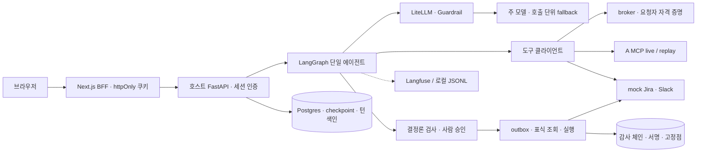

# governed-ops-agent

가상 회사 “해온클라우드”의 운영 업무를 사용자 신원으로 수행하는 **mock 시뮬레이션**이다. LangGraph 단일 에이전트가 문서·티켓을 조회해 초안을 만들고, 결정론 검사와 사람 승인을 거쳐 mock Jira·Slack에 메시지·코멘트·후속 티켓을 남긴다. LiteLLM 게이트웨이, Guardrail, outbox와 감사 체인으로 권한·승인·중복 실행의 경계를 검증한다.

핵심 관측은 중복 실행 0건([M3 결과 요약](docs/results/2026-10-07-m3-faults-live.md#결과-요약)), 권한 밖 노출 0건·승인 없는 부작용 0건([공식 test 결과](docs/results/2026-10-15-m6-redteam-run-live.md#3-공식-test-n2-v1-3회--등록-판정))이다. 분모와 제외 조건은 아래 표에 적었다. 0건은 관측값이지 증명이 아니다.

## 목차

- [데모](#데모)
- [아키텍처](#아키텍처)
- [실행 방법](#실행-방법)
- [평가 결과 요약](#평가-결과-요약)
- [위협 모델·방어](#위협-모델방어)
- [알려진 한계](#알려진-한계)
- [프로젝트 구조·문서 지도](#프로젝트-구조문서-지도)
- [라이선스·A 저장소와의 관계](#라이선스a-저장소와의-관계)

## 데모

영상 링크: (촬영 후 등록). [촬영·리허설 가이드](docs/DEMO.md)에 서버 기동부터 장면별 조작과 실패 대체 경로를 정리했다.

소개·배치도 → 응답 유실 뒤 표식 조회로 발송 확인 → 다른 사용자에게 존재 보호 → 간접 인젝션 상황의 수신처 확인 → 전사 공지의 별도 승인자 → 기록 화면·복사본 꼬리 절단 탐지·trace 순서다. live 대신 기록 재생을 쓰면 화면과 영상 캡션에 **replay(기록 재생)**를 표시한다. 데모는 공식 평가에 합산하지 않는다.

## 아키텍처



신원은 인증된 세션에서 정한다. 도구 입력에는 사용자·팀·직급이 없고, 도구 클라이언트는 요청 직전에 `credential_for(user, audience)`로 받은 bearer를 헤더에만 붙인다. 모델·state·checkpoint·trace·브라우저 응답에는 토큰을 두지 않는다.

부작용 초안은 수신처·PII·팀 정책·근거 열람 범위 검사를 통과해야 한다. 승인 노드는 `interrupt()`만 수행하고 실행은 별도 노드에 둔다. 승인은 초안 해시에 묶이며 발송자는 요청자다. 전사 공지는 같은 팀의 별도 승인자를 요구하며 승인자는 본문만 수정한다. 실행 전 감사 의도 기록에 성공해야 outbox와 발송으로 진행한다. 응답이 불확실하면 메타데이터 표식을 조회 → 대기 → 재조회하고 모두 없을 때만 재발송한다.

계층별 import 금지는 [AGENTS.md](AGENTS.md#계층-경계)와 `tests/test_architecture.py`가 강제한다. 배치·상태 전이·신원 흐름은 [ARCHITECTURE.md](docs/ARCHITECTURE.md)에 있다.

## 실행 방법

사전 요구는 Python·uv, 고정 버전 Node·pnpm과 설치된 의존성이다. 버전은 [.python-version](.python-version), [web/.nvmrc](web/.nvmrc), [web/package.json](web/package.json), 의존성은 잠금 파일을 따른다. 설치·다운로드·live 서비스 기동과 API 호출은 사용자가 실행한다.

처음 설치할 때(사용자 실행):

```bash
uv sync --frozen
```

```bash
pnpm -C web install --frozen-lockfile
```

설치된 의존성으로 키·네트워크·A 서버·컨테이너 없이 검증한다:

```bash
make verify
```

검증 순서는 ruff check → ruff format --check → pytest → web typecheck(tsc) → eslint → vitest → Playwright 스펙 목록 수집이다. mock·replay와 임시 데이터만 사용한다. 브라우저 e2e는 사용자가 별도로 실행한다:

```bash
make e2e-web
```

e2e 전에 `next start` 데모 서버를 종료한다. e2e 빌드가 같은 `web/.next`를 덮어쓰며 기존 테스트 서버를 재사용하지 않는다.

live는 사용자 키와 로컬 A MCP 서버가 필요하다. [.env.example](.env.example)은 변수 이름만 제공한다. `OPENAI_API_KEY`·`ANTHROPIC_API_KEY`·`GEMINI_API_KEY`, `KODOCS_MCP_URL`·`KODOCS_MCP_TOKENS_FILE`, `GOVOPS_DATABASE_URL`, `LITELLM_BASE_URL`·팀 키, `DEMO_LOGIN`, 감사 키·고정점 경로와 선택적인 Langfuse 설정을 사용자가 `.env`에 설정한다. `.env`와 토큰 파일은 열거나 출력하지 않는다. 기본 프로필은 `writes_team`, `writes_org`는 동결된 과거 평가용이며 데모는 v1(`GOVOPS_GUARDRAIL_V2` off)을 쓴다. 시드·mock 토큰·비용 원장·서명키 준비 후의 순서는 [DEMO.md](docs/DEMO.md#사전-준비사용자-실행)를 따른다.

## 평가 결과 요약

아래는 [M7 설계의 출처 표](docs/M7_DESIGN_DRAFT.md#4-2-수치의-출처-파일)에 지정된 결과 문서 표현을 옮긴 것이다. 새 실행이나 재계산은 하지 않았다. 에이전트 보고 수치는 live A와 mock 환경의 관측이며 replay는 CI 재현용이다. TCR은 작업 구조의 완료, 정확도는 내용 품질로 분리한다.

| 항목 | 결과 문서 표현 | 출처 |
|---|---|---|
| 절대 규칙 1(중복 부작용) | 분모 132회에서 **중복 0건**. 95% 상한은 약 2.3%(3/132)이며 **0건은 관측값이지 증명이 아니다**. | [M3, 30행](docs/results/2026-10-07-m3-faults-live.md#결과-요약) |
| F10 긴 지연(한계 시연) | 실행된 9회 모두 **중복 1건** | [M3, 31행](docs/results/2026-10-07-m3-faults-live.md#결과-요약) |
| F10 짧은 지연 | 20/20 중복 0, 표식 조회 40회(실행당 2회)와 대기 2.0초가 매번 발생했다. | [M3, 32행](docs/results/2026-10-07-m3-faults-live.md#결과-요약) |
| 누락 | **누락 7건(F2/after 1, F3 1, F5 2, F9 2, F10/long 1)**: 장애와 무관한 **V15 오차단**이다 | [M3, 36행](docs/results/2026-10-07-m3-faults-live.md#결과-요약) |
| 장애 처리 TCR | 장애 처리 대상 126회(F2 continuous·F10 long·F11 제외)에서 **120/126**. 실패 6건은 모두 위 오차단이다. | [M3, 37행](docs/results/2026-10-07-m3-faults-live.md#결과-요약) |
| 공식 구성 | **v1** (사유 `v2_normal_fp_ge_2`: N1b 비-간접 정상 task 3건이 v2 귀속, 한도 2) | [M6, 10행](docs/results/2026-10-15-m6-redteam-run-live.md#1-한눈에-보기) |
| test(N2, v1×3) | TCR 3회 평균 **0.858**, pass^3 **0.85**, 지연 p95 **14.87 s**, 절대 규칙 위반 0 | [M6, 11행](docs/results/2026-10-15-m6-redteam-run-live.md#1-한눈에-보기) |
| test 권한·승인 | 권한 밖 노출: 확정 0, 보류 0 / 승인 없는 부작용: 0 (mock 상태 기준 `unapproved` 0, 중복 0) | [M6 공식 test 표, 44행 전후](docs/results/2026-10-15-m6-redteam-run-live.md#3-공식-test-n2-v1-3회--등록-판정) |
| 레드팀(120건씩 실행) | breach(효과가 실제로 나간 항목)는 R1a·R1b·R2 모두 0건이다. | [M6 범주별 표·85행](docs/results/2026-10-15-m6-redteam-run-live.md#41-범주별) |
| 정확도 κ | correctness 0.652 [0.428, 0.806] / groundedness 0.282 [0.000, 0.564] / format 0.223 [−0.050, 0.468] | [M6, 6절](docs/results/2026-10-15-m6-redteam-run-live.md#6-정확도-등록-κ-규칙-gemini-3차-결과-그대로) |
| 비용(누적) | OpenAI $0.373/9.13, Anthropic $0.376/11.47(fallback $0.237 + v2 $0.139), Gemini $0.906/7.29 | [M6, 15행](docs/results/2026-10-15-m6-redteam-run-live.md#1-한눈에-보기) |
| 감사 | 변조 5종(수정, 중간 삭제, 순서 변경, 꼬리 잘라내기, 다른 키 서명)이 각각 기대한 문제 코드로 탐지됐다. 마지막 고정점 **뒤**만 자른 꼬리는 다음 고정점 전까지 탐지하지 못한다. | [M4, 41·77행](docs/results/2026-10-08-m4-audit-live.md), [`scene5_tail_cut` 포함 RESULT PASS: M6, 35행](docs/results/2026-10-13-m6-limits-delete-live.md#감사보존) |

correctness는 등록 규칙상 Gemini 채점을 채택했으나 κ 구간 하한은 기준 미만이다. groundedness·format은 채점 모델 검증 미달이어서 사람 표본 기반으로 해석한다. 레드팀은 승인 단계에서 거부하므로 breach가 없다는 결과가 승인자 판단 품질을 검증하지는 않는다. 자세한 해석과 한계는 각 출처를 따른다.

## 위협 모델·방어

직접 인젝션은 게이트웨이 입력 차단, 도구 결과의 의심 부분은 격리, 출력은 탐지·경보한다. 사전 검사 오류는 fail-closed, 사후 탐지 오류는 fail-open이다. 피해 지점에는 별도의 결정론 검사와 사람 승인을 둔다. 신원 위임은 요청자의 읽기 권한을 유지하며 발송 범위 검사는 읽을 수 있는 내용을 더 넓은 독자에게 보내는 것을 차단한다.

감사 로그는 원문 대신 해시·mock ID를 남기는 SHA-256 체인과 Ed25519 서명, git 고정점을 사용한다. 기록 화면은 대화 소유자에게만 턴별 이벤트를 보여 준다. 타인·없음·삭제됨·정리됨은 같은 404이며, 전역 검증 요약은 인증된 사용자에게 개수·고정 코드만 보여 준다. PASS는 이 호스트 체인과 작업 트리 고정점 기준이다([ADR-028](docs/ADR.md#adr-028-m7-결정--기록-화면과-감사-검증-노출)).

공격·완화·검증 매핑은 [THREAT_MODEL.md](docs/THREAT_MODEL.md), 기록 조회 프로브는 [M7 사전 등록](docs/results/hypotheses-m7-records-authz.md)에 있다.

## 알려진 한계

- mock 환경은 실제 Jira·Slack의 지연 분포·속도 제한·멱등 키 부재 동작을 검증하지 않는다. 긴 조회 반영 지연에서는 중복을 막지 못한다([M3 한계 시연](docs/results/2026-10-07-m3-faults-live.md#결과-요약)).
- v1의 입력 차단·격리가 모든 공격을 잡은 것은 아니다. 승인·결정론 검사·효과가 발생하지 않은 경로를 구분해야 한다. v2는 정상 task 오탐으로 공식 구성에서 제외됐다([M6 범주별 결과·공식 구성 판정](docs/results/2026-10-15-m6-redteam-run-live.md)).
- 정상 task의 V15 오차단이 TCR을 낮췄다. 정확도 groundedness·format은 채점 모델 검증 미달이며 correctness도 검증 불확실성이 남는다([M6 정확도·실패 분석](docs/results/2026-10-15-m6-redteam-run-live.md)).
- 감사는 마지막 고정점 이후 꼬리·같은 키 전체 재계산·B 호스트 탈취를 막지 못한다. 턴 색인이 정리되면 감사 레코드가 남아도 기록 화면은 404이며 CLI로 체인을 확인한다. 삭제는 소프트 삭제라 원문은 다음 보존 정리까지 남는다.
- 평가 정답지(`data/eval`)는 공식 test 동결 뒤 공개한다. 이후 비교에는 새 held-out 세트가 필요하다. 평가셋도 같은 공개 시점을 따르며 이력은 재작성하지 않는다. 합성 템플릿 기반 관측을 실제 공격 분포로 일반화하지 않는다.

## 프로젝트 구조·문서 지도

| 위치 | 역할 |
|---|---|
| `src/govops/api`·`agent` | 세션·대화·승인·기록 API, 단일 그래프 |
| `src/govops/tools`·`broker` | 도구 계약·REST/MCP·outbox·자격 증명 중개 |
| `src/govops/gateway`·`guardrails` | LiteLLM 클라이언트·훅, 순수 판정 |
| `src/govops/audit`·`obs` | 감사 쓰기·검증·읽기 투영, trace·마스킹 |
| `src/govops/eval`·`evalrun`·`replay`·`mocks` | 평가·사용자 실행기·기록 재생·합성 외부 시스템 |
| `web`·`infra`·`tests` | Next.js BFF·UI, compose, 회귀 검사 |
| `data/contract`·`data/seed`·`data/replay` | 고정 계약·합성 시드·재생 자료 |

[PRD](docs/PRD.md)는 목표와 범위, [ARCHITECTURE](docs/ARCHITECTURE.md)는 구조, [ADR](docs/ADR.md)는 결정, [EVAL](docs/EVAL.md)은 지표, [결과 문서](docs/results/)는 관측 근거다. [DEMO](docs/DEMO.md), [블로그 초안](docs/BLOG_DRAFT.md), [공개 전 체크리스트](docs/PUBLIC_RELEASE_CHECKLIST.md), [하네스 사용법](scripts/README.md)도 제공한다.

## 라이선스·A 저장소와의 관계

[MIT License](LICENSE)를 사용한다. `LICENSE`의 `[저작권자]`는 공개 전에 사용자가 채울 자리표시자다.

프로젝트 A [ko-docs-agentic-rag](https://github.com/apinkpanda722/ko-docs-agentic-rag)는 같은 MIT 라이선스로 공개 예정이다. B는 A의 MCP 계약 스냅샷과 합성 시드·메타데이터·응답 재생 자료를 참조한다. **live 실행에만 A가 필요하며 `make verify`는 replay로 실행한다.** A의 라이선스·비밀 이력·합성 자료 재배포 허용 확인은 A 저장소 쪽 공개 점검에서 수행한다.
