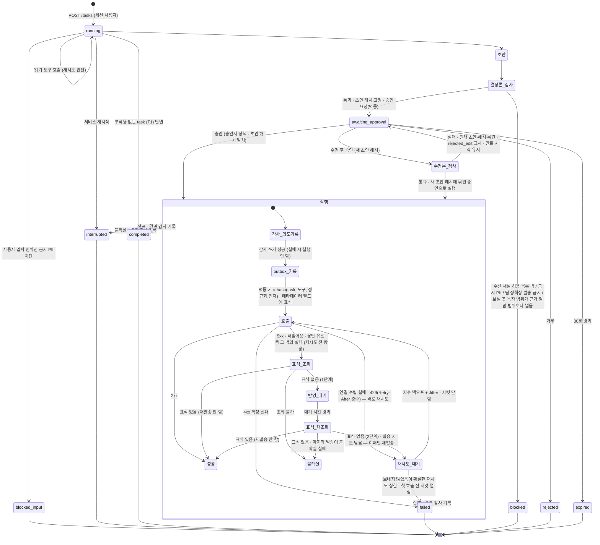
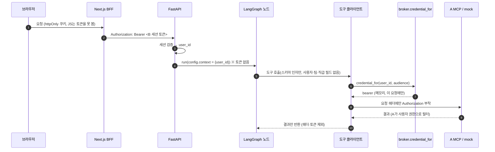
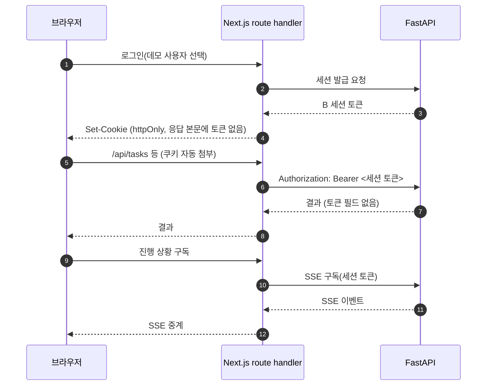

# 아키텍처

보안 경계·위협·완화와 검증 매핑은 [THREAT_MODEL.md](THREAT_MODEL.md), 결정 근거는 [ADR.md](ADR.md), 지표는 [EVAL.md](EVAL.md)를 참조한다.

표기 규칙:
- **확인 필요(구현 시 공식 문서로 확인)**: 결정 기록에서 사실 확인이 남은 항목. 단정하지 않는다.
- **미정(구현 phase에서 결정)**: 결정 기록에 없는 구현 세부. 해당 phase 설계 때 정하고 ADR에 남긴다.

## 디렉토리 구조
패키지 이름은 `govops`(`src/govops/`)다(ADR-016).

```
src/govops/
├── api/          # FastAPI: B 세션 인증, POST /tasks, GET /tasks/{id}, POST /tasks/{id}/approval, 진행 SSE
│   ├── sessions.py·auth.py·users.py·startup.py·app.py  # M1 세션·인증·task API
│   └── tasks.py·wiring.py·cli.py·smoke.py  # 백그라운드 task·build_task_service 서비스 조립·CLI·사용자 스모크
├── agent/        # LangGraph 단일 에이전트: 상태·노드·그래프, 실행 전 결정론 검사, 승인 정책, MAX_STEPS/MAX_COST
│   ├── org_info.py  # 8팀 대응표·티켓 열거형·결정론적 조직 정보 절
│   ├── draft.py  # 초안 타입·정규화 해시
│   ├── checks.py  # 수신처·PII 결정론 검사
│   ├── scope.py  # 구조 기반 근거·V15 발송 범위
│   ├── approval.py  # 승인자 정책·본문 수정·승인 ID
│   └── prompts.py·graph.py·checkpointer.py  # 한국어 프롬프트·읽기·쓰기 그래프·DB 팩토리
├── tools/        # 도구 계약(스키마·버전·부작용 여부), A MCP 클라이언트, mock REST 클라이언트, outbox·표식 조회, 타임아웃·재시도·서킷
│   ├── markers.py  # 정규화 멱등 키·메타데이터 표식
│   ├── fault_transport.py  # F4 클라이언트 쪽 연결 수립 실패·시도/주입 카운터
│   ├── resilience.py  # 도구 타임아웃·읽기 재시도·서비스별 서킷
│   ├── outbox.py  # 해시 전용 in-memory·Postgres outbox
│   └── effects.py  # 2단계 표식 조회 실행·재발송 없는 정리
├── broker/       # credential_for(user, audience) — 자격 증명을 꺼내는 유일한 지점
├── gateway/      # LiteLLM 호출 클라이언트(에이전트의 유일한 모델 경로), LiteLLM 안에서 도는 Guardrail 훅 어댑터
│   ├── faults.py  # 하네스 전용 호출 번호별 모델 장애 주입
│   ├── smoke.py  # 사용자 실행 fallback·원장·백엔드 확인
│   └── client.py·agent_key.py  # 비동기 모델 호출·전용 가상 키 발급
├── guardrails/   # 순수 Python 판정: 한국 형식 PII 정규식, 인젝션 패턴 사전, 팀별 정책 표 로더 (v2 분류기는 gateway 경유 호출)
│   ├── policy.py  # 팀별 정책 로더
│   └── pii.py    # 한국 형식 PII 판정
├── audit/        # 감사 로그 해시체인·서명 쓰기(유일한 쓰기 지점), audit-verify
│   └── log.py  # M3 비체인 JSONL·AuditPort·결과 기록 재시도
├── obs/          # trace span, 전송 전 마스킹, 로컬 JSONL / Langfuse 출력
│   └── trace.py·mask.py·jsonl.py·langfuse.py
├── env.py        # 빈 문자열·공백을 미설정으로 처리하는 env_or
├── costs.py      # 공급사별 비용 원장·전체 기간 상한(호출 직전 누적액 검사)
├── evalrun/      # 사용자 실행 dev 평가·관측·골든 record-through
│   ├── dev.py·explore.py  # M2 공용 헬퍼·구조 필드 기반 N 후보
│   ├── observe.py  # API 상태·승인 기록·mock 상태를 M3 관측으로 변환
│   ├── mock_admin.py  # compose 내부 관리 CLI 래퍼
│   ├── driver.py  # 세션 인증 in-process ASGI 승인 계획 실행
│   ├── preflight.py  # mock 이미지·LiteLLM 배포·서비스 확인
│   ├── tool_trace.py  # 자격 증명 없는 공용 도구 호출·구조 ID 추출
│   ├── faults.py·fault_scenarios.py·faults_smoke.py  # 장애 계획·판정·재개·부품 스모크
│   ├── run_guards.py  # M6 실행 등록·구성·작업 트리·분류 카운터 사전 가드
│   ├── overlay_env.py  # 레드팀 오버레이 시드·조회 정합 검사
│   ├── redteam_run.py  # 레드팀 120건 순차 실행·승인 거절·본문 없는 원자료·manifest
│   └── dev_m3.py  # dev 20 writes_org 실행·task별 캡처·절대 규칙·모델 혼합 보고
├── eval/         # 메타데이터 추출(meta.py·meta_extract.py), 명세·권한(spec.py·visibility.py), 생성기(taskgen.py), 카드·검수(cards.py·cards_content.py·cards_text.py·cards_assets.py·a_source.py·review.py·review_cli.py), TCR(observation.py·tcr.py·aggregate.py·rules.py), 정확도·채점(accuracy.py·grading.py·kappa.py·human.py·grading_cli.py, Gemini 직접 호출·별도 원장)
│   ├── scope_index.py  # 접근 전용 인덱스 생성
│   ├── v2_validity.py  # 고정 95% 기준·시도 0건의 v2 실행 유효성 판정
│   ├── redteam_judge.py  # 레드팀 원자료 검증·판정·집계·쌍 비교·기술 통계
│   ├── run_summary.py  # 실행·반복 요약·dev 근거의 공식 구성 판정·읽기 전용 CLI
│   └── duplicates.py  # mock 상태 기반 중복·누락 집계
├── replay/       # 가짜 A MCP 서버, llm.py(LLM 응답 기록·재생), a_through.py·a_replay.py(A record-through·순차 재생)
│   └── chaos_a.py  # F11 루프백 원시 장애 서버·합성 토큰·fact 판정
├── golden.py     # 골든 기대값·자격·결정론 재생 조립
└── mocks/        # mock-jira·mock-slack FastAPI 서비스, 장애 주입, 관리 엔드포인트
    └── faults.py  # 엔드포인트별 순번 장애 주입
web/              # Next.js(App Router, TypeScript): 화면 4개 + BFF route handler, Tailwind, shadcn/ui
infra/
├── postgres/init/01-create-databases.sh  # litellm·langfuse·govops 앱 DB 초기화 계획(ADR-017, m1-agent)
├── litellm/config.yaml                  # LiteLLM 주 모델·환경 변수 참조·배포별 model_info.id 설정
│                                       # agent-fallback·agent-primary-only·agent-primary-down 별칭(ADR-019)
├── litellm/config.obs.yaml              # obs 전용 Langfuse 콜백·원문 로깅 끔
├── mocks/Dockerfile                     # mock-jira·mock-slack 공용 이미지
├── docker-compose.yml                   # LiteLLM·Postgres·mock 2개, profile obs: Langfuse v3 스택
└── docker-compose.redteam.yml           # 레드팀 전용 mock-jira 오버레이 읽기 전용 마운트·환경 변수
data/
├── contract/     # A 계약 스냅샷(도구 4개 v1) + A 커밋 해시 (커밋, 수정 금지)
├── seed/         # tickets.json·users.json(label·team·grade)·mock_jira_token_hashes.json·mock_slack_token_hashes.json·manifest.json(추출 A 커밋 해시·개수) (커밋)
│   └── access_index.json  # 문서·티켓 접근 전용 인덱스
├── policy/
│   └── team_policy.json  # 팀별 수신처·PII 정책
├── replay/       # requests.json, a/recordings.jsonl(A 응답, syn-*만, 토큰·Authorization 없음), llm/(LLM 응답·프롬프트 해시), a_run/(실행별 A 응답), golden/(expectations.json·status.json) (커밋)
├── eval/         # 평가 메타데이터·60 task 명세
│   ├── meta.json·meta.manifest.json  # 합성 메타데이터·추출 manifest
│   ├── doc_titles.json             # 문서 제목(plan.jsonl title_hint). 요청 문장의 문서 지칭용이며 meta.json 해시에 영향 없음
│   ├── tasks.json·tasks.manifest.json  # 생성 명세·분포 및 검증 manifest
│   ├── review/confirmed.json       # 사람이 작성한 해시 기반 확정본
│   ├── review/leak_confirmations.json  # 사람이 작성한 노출 후보 판정(절대 규칙 2)
│   └── human/                      # scores.csv·human_sample.json 블라인드 사람 채점 표본
├── results/      # dev/<run_id>/ 관측 JSONL·trace·채점·manifest·모든 시도 기록
├── manifest/     # costs.jsonl·costs_grading.jsonl (커밋)
├── raw/          # 커밋 안 함
└── interim/      # 커밋 안 함 (감사 서명 개인키 0600 등)
    ├── audit/      # 감사 체인 JSONL·legacy·고정점 대기 파일, 0600(ADR-012)
    └── eval/cards/  # 오프라인 검수 카드 HTML 한 장(index.html: 목록·카드 60장·판정 저장), 본문 발췌 포함이라 커밋 안 함
docs/HUMAN_GRADING_GUIDE.md  # 공식 test 1회차 블라인드 사람 채점·CSV 해시 등록 안내
docs/results/     # 결과표, 가설 사전 등록, 감사 고정점 audit-anchors.jsonl (대기 파일에서 결과 PR로 이동)
└── human-grading-registration.json  # docs/results/human-grading-registration.json, 사람 CSV 해시 등록
logs/             # 로컬 JSONL trace (커밋 안 함)
└── traces/<task_id>.jsonl  # task별 마스킹 span
tests/
```

`data/contract/`·`data/seed/`·`data/replay/`는 확정 경로다. `data/eval/` 하위 구조는 위와 같고, 감사 로그 저장 경로는 `data/interim/audit/`(0600)다(ADR-018). 계층 간 import 금지 규칙은 [AGENTS.md](../AGENTS.md#계층-경계)가 원본이다.

## 배치도

구현 모듈: `replay.llm`·`replay.a_through`·`replay.a_replay`는 안전한 기록과 순차 재생, `govops/golden.py`는 골든 실행 조립, `evalrun.dev`는 M2 공용 헬퍼, `evalrun.explore`는 구조 필드 기반 N 후보 계산을 맡는다.

```mermaid
flowchart LR
  subgraph Browser[브라우저]
    UI[web 화면 4개]
  end
  subgraph Host[호스트]
    BFF[Next.js BFF<br/>httpOnly 세션 쿠키]
    SVC[B 에이전트 서비스<br/>uv run · FastAPI + LangGraph<br/>broker · audit · obs]
    ALIVE[A MCP 서버 live<br/>127.0.0.1 고정]
    AREPLAY[가짜 A MCP replay<br/>기록 재생]
    TOK[(A tokens.json<br/>.env 경로 변수로 실행 시 읽기)]
    AUD[(감사 로그 JSONL)]
  end
  subgraph Compose[B docker compose]
    LLM[LiteLLM proxy<br/>팀 가상 키 · Guardrail 훅]
    PG[(Postgres<br/>LiteLLM DB · Langfuse DB · govops 앱 DB(checkpointer·outbox))]
    MJ[mock-jira]
    MS[mock-slack]
    subgraph OBS[profile obs]
      LF[Langfuse v3 web·worker<br/>ClickHouse · Redis · MinIO]
    end
  end
  PROV[OpenAI 주 모델<br/>Anthropic fallback · v2 분류기]
  GEM[Gemini 채점]

  UI -->|same-origin| BFF -->|Bearer B 세션| SVC
  SVC -->|streamable HTTP| ALIVE
  SVC -.->|CI·외부 검토자| AREPLAY
  SVC --> TOK
  SVC --> AUD
  SVC -->|REST| MJ
  SVC -->|REST| MS
  SVC -->|팀 키 · OpenAI 호환 API| LLM --> PROV
  LLM -->|x-govops-guardrail · 해시 검증| SVC
  LLM --> PG
  LLM -.->|trace| LF
  SVC --> PG
  SVC -.->|trace| LF
  SVC -.->|eval만, 게이트웨이 미경유| GEM
```

- 에이전트 서비스가 호스트에 있는 이유: A MCP는 `127.0.0.1` 고정이고 MCP SDK가 이 경우 Host 헤더 검사를 켠다. 컨테이너에서 `host.docker.internal`로 붙으면 네트워크에는 도달하지만 인증된 요청도 Host 검사로 421 거절된다(M1 실측, ADR-004). A는 고치지 않는다.
- 핵심 스택(LiteLLM·Postgres·mock 2개)은 Langfuse 없이 뜨고, 이때 trace는 로컬 JSONL로 남는다. Langfuse는 `docker compose --profile obs`로만 뜬다(ADR-009).
- Postgres 인스턴스 하나에 LiteLLM·Langfuse DB를 나눠 둔다. M0 init은 `litellm`·`langfuse` DB만 만들고 checkpointer DB는 만들지 않는다(ADR-016). LangGraph checkpointer는 같은 인스턴스의 `govops` 앱 DB에 둔다. `m1-agent`에서 init 스크립트에 추가하고 기존 볼륨에는 멱등 `make db-init`을 제공한다. 연결 변수는 `GOVOPS_DATABASE_URL`이다(ADR-017).
- web은 호스트에서 `cd web && pnpm dev`로 실행하고 compose에 넣지 않는다(ADR-016).
- mock 관리 엔드포인트(초기화·장애 주입 설정·상태 조회)는 compose 내부 네트워크에만 연다. REST 포트(컨테이너 8000)만 `127.0.0.1`에 publish하고 관리 포트(9000)는 publish하지 않는다. 호스트 접근 경로는 컨테이너 안 CLI `docker compose -f infra/docker-compose.yml exec <mock> python -m govops.mocks.admin <명령>`이다(ADR-016, `<mock>`은 `mock-jira` 또는 `mock-slack`). 평가 하네스의 상태 조회와 M3 장애 주입도 이 경로를 쓴다. CLI는 `health`·`state`(상태 조회)·`reset`(초기화)을 제공하고, 장애 주입 명령은 `faults set/clear/stats`이며 `state --bodies`로 본문 포함 상태를 조회한다(ADR-018). mock 코드가 바뀐 PR을 머지한 뒤에는 `docker compose -f infra/docker-compose.yml up -d --build mock-jira mock-slack`으로 mock 이미지를 다시 빌드한다.
- Docker VM은 약 16GB(A OpenSearch와 공유)다. 첫 기동 후 `docker stats`로 실측하고, 부족하면 Docker 메모리를 늘린다.

평가 실행기 `evalrun/dev_m3.py`는 `api/wiring.py`의 `build_task_service`로 서비스를 조립하며 `audit`·`guardrails`를 직접 import하지 않는다. `observe.py`는 초안 대신 mock 상태로 효과를 센다. `mock_admin.py`는 내부 관리 CLI를 호출하고 `driver.py`는 인증된 세션으로 실제 승인 API를 거친다. dev 20은 `PROFILES["writes_org"]`로 실행하고 공식 채점은 `m3-grading`이다(ADR-021). 등록 묶음은 `hypotheses-m3.md`·`data/replay/golden/expectations.json`·`m3-dev-supersedes.json`과 `hypotheses-m3-prompt.md`·`m3-dev2-supersedes.json` 두 개다(등록 문서·supersedes 파일은 `docs/results/` 아래). 각 묶음이 등록 커밋에 존재하지 않거나 이후 바뀌면 `hypotheses_m3_not_committed`·`hypotheses_m3_prompt_not_committed`로 중단하며 청결한 작업 트리도 검사한다. manifest에는 각 등록 파일의 sha256·등록 커밋과 `supersedes`(두 번째 파일)·`previous_supersedes`(첫 번째 파일)를 남긴다. `m3-dev-supersedes.json` ← `m3-dev2-supersedes.json` 사슬로 이전 결과를 보존한다. live dev는 Postgres 필수이며, in-process ASGI 경로는 실제 서버 프로세스·세션 TTL을 검증하지 않는다. `preflight.py`가 낡은 mock 이미지·미반영 LiteLLM 설정·서비스 장애를 막는다(ADR-020).

골든 대상은 `hypotheses-m3.md`에 등록한 14개다. record-through는 이 14개만 수행하고 `profile`은 `writes_org`로 저장한다. 두 번째 실행 직후 골든 14개를 `writes_org`로 재기록하고 `expectations.json`은 그대로 둔다(ADR-021). 쓰기 재생은 도구 순서·부작용 종류·대상·건수·종료 상태·거절·금지 도구 호출·승인자와 결정 순서를 비교하며 승인 ID·mock ID는 제외한다. `evalrun/tool_trace.py`는 도구 결과의 구조 ID를 추출한다. `evalrun/dev_m3.py`는 task 시도별 캡처를 격리하고 늦은 호출은 `late_tool_calls`로만 센다. `tool_trace_mismatch` task는 N 계산에서 제외하며 하나라도 있으면 결과 첫머리에 표시하고 원인 확인 전 N 등록을 보류한다(`n_registration_blocked`).

## A 연동 모드
| 모드 | A 쪽 | 용도 | 보고 수치 |
|---|---|---|---|
| live | 실제 A MCP 서버(호스트, 사용자 기동) | 개발·평가·데모 | 이 모드만 |
| replay | 기록한 A 응답을 돌려주는 가짜 A MCP 서버 | CI, 외부 검토자 | 쓰지 않음 |

- 기록은 사용자가 실행하고 합성 문서(`syn-*`)만 남긴다. 실제 규정 원문 재게시를 막는 검사 테스트를 둔다. 토큰·Authorization 헤더는 기록하지 않는다.
- 계약 고정: A `tests/contract/snapshots`(도구 4개 v1)를 A 커밋 해시와 함께 복사한다. 서비스 시작 시 live `tools/list`와 비교해 다르면 중단한다. 가짜 A도 같은 계약 테스트를 통과해야 한다. B의 MCP 클라이언트 테스트는 실제 streamable HTTP로 가짜 A에 요청한다.
- A 버전 기록: live 실행마다 A git HEAD·계약 스냅샷 해시·인덱스 이름을 기록한다. 기준 A 커밋은 `d2eec9c`이고, 다르면 경고만 기록한다(계약 불일치는 시작 단계에서 이미 중단된다).
- 정답 출처: A 합성 문서 메타데이터(`doc_id`, 권한 필드, `fact_id`·값, 본문 없음, `syn-*`만)를 일회성 스크립트로 추출해 커밋한다(사용자 실행). A 커밋 해시·개수는 manifest에 둔다(ADR-010).
- A MCP 장애(지연·5xx·연결 거부)는 A를 고칠 수 없으므로 replay 가짜 A에 주입한다(F11).

## 에이전트 상태 전이

승인 노드 핵심(`interrupt`, 초안 해시 결합, `POST /tasks/{id}/approval`)과 전사 공지 승인자 정책(요청자 팀 4급 이상, 요청자 본인 제외)은 M3에서 구현한다. M3 장애 주입의 중복 0건 검증에는 승인을 거치는 부작용 실행 경로가 필요하다. M5는 웹 화면(로그인·요청 진행·승인함), MAX_STEPS/COST, 탐색 예산(ADR-014), checkpointer 보존 기간 삭제(ADR-015)를 구현한다.

승인 노드에는 `interrupt()`만 두고 실행은 별도 노드에 둔다. LangGraph는 `Command(resume=...)` 재개 시 멈춘 노드를 처음부터 다시 실행하므로, 실행을 승인 노드에 두면 재개할 때마다 부작용이 반복될 수 있다(ADR-011).



그림의 초안·검사·실행 내부 상태는 처리 단계이며 task 응답의 상태는 `running`·`awaiting_approval`·`completed`·`failed`·`blocked`·`blocked_input`·`rejected`·`expired`·`interrupted`다.

- MAX_STEPS(8) 도달 시 이번 턴 성공 읽기 `turn_read_ok >= 1`을 먼저 확인하고, 이어 `turn_cost_usd >= MAX_COST_USD`를 확인한다. 성공 읽기가 없거나 비용 상한이면 마지막 호출을 생략하고 `failed/max_steps`로 끝낸다. 그 밖에는 같은 도구 정의에 고정 안내문을 덧붙여 마지막 답변 호출 1회를 하며 `steps`는 8로 유지한다. 도구 호출이 오거나 본문이 비면 `failed/max_steps`이며 도구 실행·초안 생성은 하지 않는다. 본문만 있으면 `completed`, `stop_reason="max_steps_finalized"`다. 상한 미만의 MAX_COST($0.40) 검사는 기존 `failed/max_cost`를 유지한다(ADR-013·ADR-025).
- `turn_read_ok`는 턴마다 초기화하며 ID 없는 성공 읽기도 센다. 대화 범위 `evidence_ids`는 마무리 호출 조건에 쓰지 않는다. 마지막 호출도 gateway·Guardrail·비용 원장·성공 모델 감사 경로를 거치며 시스템 프롬프트·도구·프롬프트 해시와 상한 미만 호출은 불변이다. 골든 재기록·dev 재실행은 하지 않고 `max_steps_finalized` 턴은 N 재계산에서 제외한다([사전 등록](results/hypotheses-m6-finalize.md), ADR-025).
- 탐색 예산(ADR-014): MAX_STEPS와 별도로, `running`에서 새 정보 없는 호출(결과에 이전까지 없던 문서·티켓 ID가 없는 도구 호출)이 N=4회 연속이면 그 턴을 `completed`와 고정 답변 "요청하신 정보를 찾을 수 없습니다."로 끝내고 관측 필드 `stop_reason=exploration_exhausted`를 남긴다(화면 비노출). N은 공식 dev 실행 전체의 성공 task별 최대 연속 무정보 호출 수의 최댓값 + 1이며 `docs/results/n-registration-m5.md`에 등록돼 있다. 권한 판정은 계속 에이전트에게 숨긴다. 사람 승인 대기 시간은 지연·MAX_STEPS·MAX_COST에서 제외한다.
- 승인은 초안 내용 해시에 묶는다. 승인 시점의 해시와 실행할 초안의 해시가 다르면 실행하지 않는다(TOCTOU 방지).
- 승인자 정책: 기본은 요청자 본인. **전사 공지 채널 발송만 요청자 팀 4급 이상이면서 요청자 본인이 아닌 사용자**가 승인한다(A 등급은 숫자가 클수록 상위). 승인자 신원은 세션에서 정한다.
- V15 근거는 비어 있지 않은 `text`를 가진 문서(`search_docs`·`get_document`·`lookup_id`)와 레코드가 돌아온 티켓이다. `run_sql`의 `ticket_id` 열 값은 티켓 근거이며 ID 없는 집계·열 값은 범위 검사에서 제외한다. 접근 필드와 사용자 팀·직급만 담은 `data/seed/` 인덱스에 없는 근거는 차단한다. 문서 단위 검사는 평가 정답의 값 기준 판정보다 엄격하고 잘못 막힌 건은 TCR 실패·dev 보고 대상이다. 에이전트는 `data/eval/`을 읽지 않는다(ADR-018).
- 전사 공지는 요청자가 4급 이상이어도 본인 승인은 403이다. 그 밖의 채널·티켓 작업은 요청자 본인만 승인하고 다른 사용자의 task는 404다(ADR-018).
- 본인 승인의 의미: 결재가 아니라 "에이전트가 해석한 결과(수신처·초안·결정론 검사 결과)의 확인"이다. 직무 분리는 전사 공지에만 둔다.
- 발송 신원은 요청자다(`credential_for(요청자)`). 승인자는 본문만 수정할 수 있고 수신처는 바꿀 수 없다(바꾸려면 거부 후 새 요청). 승인자와 수정 전후 초안 해시를 감사 로그에 남긴다.
- 수정 후 승인은 수정본에 결정론 검사를 다시 돌린다. 통과하면 새 초안 해시에 묶인 승인으로 바로 실행하고, 실패하면 원래 초안·원래 해시로 승인 대기를 복원하고 `rejected_edit`에 막힌 이유를 보여 준다. 만료 시각은 유지한다.
- **부작용 도구는 재시도 전에 항상 표식 조회를 한다.** 조회는 2단계(조회 → 대기 → 재조회)이고, 표식이 있으면 성공, 두 번 모두 없을 때만 재시도다. 대기 시간은 2.0초다(ADR-018). 500·502·504 같은 5xx는 서버가 처리한 뒤 실패를 돌려줄 수 있으므로 바로 재시도하지 않는다. 바로 재시도해도 되는 것은 연결 수립 실패와 429(`Retry-After` 준수)뿐이다. 읽기 도구는 재시도해도 안전하다.
- 읽기 도구의 재시도 값(횟수·백오프·서킷·Timeout)은 ADR-018을 따른다. 연결 수립 실패·429·타임아웃·5xx·전송 오류를 재시도한다.

승인 API 응답은 접수 202, 종료된 동일 해시·결정의 영수증 재요청 200, 전사 공지 요청자 본인의 승인 POST만 403, 다른 사용자·자격 없음·없는 task 404, 만료·상태·해시 충돌 409, 잘못된 수정·요청 422다. 승인자 GET은 검사 통과 상태(`passed`·`masked`)의 승인 대기 초안만 보여 준다.

### 대화 삭제 API

| API | 성공 상태 | 응답 본문 |
|---|---|---|
| `DELETE /conversations/{conversation_id}` | 200 | `{conversation_id, deleted}` (`deleted: true`) |

삭제 신원은 인증된 세션의 요청자이며 첫 턴 ID가 대화 ID다. 타인·없음·삭제됨·형식 오류는 동일한 404 `conversation_not_found`, 실행 중은 409 `turn_in_progress`, 승인 대기·interrupt는 409 `approval_pending`이다. 만료된 승인은 대화 → task 잠금 안에서 먼저 닫는다. 감사 싱크 없음·쓰기 실패는 500 `audit_write_failed`, 표시 실패는 500 `delete_failed`이며 BFF는 내부 실패를 502 `upstream_unavailable`로 접는다. `approver_decision` 규칙은 유지한다. 삭제 확인은 대화 조회·턴 추가·SSE·task 조회·승인·승인함에도 적용하며 task 라우트는 기존 404 `Task not found`를 사용한다(ADR-025).

`PROFILES = {writes_org}`인 읽기 전용 단일 레지스트리를 사용한다. `GOVOPS_AGENT_PROFILE` 허용값과 기본값은 `writes_org`다. `WITH_WRITES_ORG`는 조직 정보 절을 포함하며 `READ_ONLY`·`WITH_WRITES` 구성 객체는 단위 테스트·프로필 구성에 유지한다. M2 러너의 실행 경로는 삭제하고 공용 헬퍼·과거 결과 문서는 보존한다(ADR-022). 시작 정리는 checkpointer 전체 순회이며 수백 건 규모를 전제한다. 규모가 커지면 별도 테이블이 필요하다.

## 도구와 부작용·멱등성

| 도구 | 대상 | 부작용 | 승인 | 멱등성 전략 |
|---|---|---|---|---|
| `search_docs` | A MCP | 없음 | 불필요 | 읽기, 재시도 안전 |
| `lookup_id` | A MCP | 없음 | 불필요 | 읽기, 재시도 안전 |
| `run_sql` | A MCP | 없음 | 불필요 | 읽기(A가 SELECT만 허용), 재시도 안전 |
| `get_document` | A MCP | 없음 | 불필요 | 읽기, 재시도 안전 |
| `jira_get_ticket` | mock-jira | 없음 | 불필요 | 읽기, 재시도 안전 |
| `jira_search_tickets` | mock-jira | 없음 | 불필요 | 읽기, 재시도 안전 |
| `slack_send_message` | mock-slack | 있음 | 필요(전사 공지는 요청자 팀 4급 이상, 요청자 본인 제외) | outbox + 메시지 메타데이터 표식 → 재시도 전 채널 최근 이력에서 2단계 조회 |
| `jira_add_comment` | mock-jira | 있음 | 필요 | outbox + 코멘트 메타데이터 표식 → 재시도 전 해당 티켓 코멘트 목록에서 2단계 조회 |
| `jira_create_followup_ticket` | mock-jira | 있음 | 필요 | outbox + 티켓 메타데이터 표식 → 재시도 전 원 티켓의 하위(후속) 티켓 목록에서 2단계 조회 |

- **멱등성은 B가 보장한다.** mock은 실제 서비스처럼 서버 측 중복 제거를 하지 않는다. **확인 필요(구현 시 공식 문서로 확인): 실제 Slack 메시지 발송·Jira 이슈 생성·코멘트 API에 서버 측 멱등 키가 있는지.** 결정 기록은 "없다"는 전제로 설계했다(ADR-006).
- 표식은 본문이 아니라 메타데이터 필드에 둔다(본문 표식은 사용자에게 보이고 사람이 수정하면 사라진다). **확인 필요(구현 시 공식 문서로 확인): 실제 대응 필드(Slack 메시지 메타데이터, Jira 이슈 속성).** 조회는 채널 최근 이력·티켓 하위 목록으로 하고 검색 API는 쓰지 않는다(검색은 반영이 늦을 수 있다).
- 2단계 조회: 조회 → 대기 → 재조회 후 둘 다 없을 때만 재발송한다. 대기보다 짧은 조회 반영 지연은 절대 규칙 대상이고, 긴 지연은 한계 시연으로 절대 규칙에서 뺀다(F10, 사전 등록).
- outbox 순서: ① 감사 로그에 실행 의도 기록 → ② outbox에 멱등 키·상태 기록 → ③ 메타데이터 필드에 표식을 넣어 호출 → ④ 결과를 outbox·감사 로그에 기록. 같은 멱등 키가 이미 성공이면 호출하지 않는다.
- POST마다 직전에 발송 번호를 포함한 실행 시도 감사 이벤트를 fail-closed로 기록한다. 결과 기록 실패는 재시도 후 `audit_gap`으로 표시한다. 조회 불가·마지막 불확실 실패는 불확실로 종료하고 재시작 정리는 표식 조회만 한다(ADR-018).
- 핵심 장애는 "서버는 처리했는데 응답 유실"이다. 이때 재발송하면 중복, 포기하면 누락이므로 표식 조회로 판정한다.
- 티켓 생성은 기존 티켓의 후속 티켓으로만 한다(원 티켓 연결 필수, 독립 티켓 생성은 범위 밖). 그래서 표식 조회 대상은 항상 원 티켓의 후속 티켓 목록이고 검색 API가 필요 없다.
- 도구 이름은 위 표의 9개로 확정한다(ADR-017). A 계약 이름을 유지하며 B 도구는 `{시스템}_{동사}_{대상}` snake_case다. 표식 값 형식, 2단계 조회 대기 시간, outbox 저장소는 ADR-018을 따른다.
- `jira_create_followup_ticket` 입력 스키마는 `parent_ticket_id`를 필수로 둔다. 모든 도구 입력에 사용자·팀·직급 필드는 없다. 채널 이력·코멘트 목록·후속 티켓 목록 조회는 표식 조회용으로 도구 계층만 쓰고 모델에는 노출하지 않는다. mock-slack 이력은 자기 팀 채널·전사 공지만 허용하며 그 밖은 403이다.
- "원 티켓 없이 티켓 생성 요구"를 레드팀·T5 거절 사례로 넣을지는 미정(M6에서 결정)이다.
- mock 응답 비대칭: 읽기 권한 거부와 읽을 수 없는 티켓에 대한 쓰기 요청(코멘트·후속 티켓)은 "없음"과 구별되지 않는 응답(mock-jira 404)이다. 명시적 "권한 없음"(403)은 존재가 공개된 mock-slack 채널(채널 목록은 공개 정보)의 쓰기·이력 조회에만 쓴다.
- mock-jira 티켓 조회 권한은 A와 같은 규칙(`access_level`·`access_teams`·`access_min_grade`)이다. live에서 38명 × 표본 티켓 가시성을 A와 대조하는 테스트를 둔다.

## 자격 증명 중개 흐름 (`credential_for`)



- audience: A MCP(`kodocs-mcp`), mock-jira, mock-slack. 같은 중개를 거치고 audience만 다르다. 실무 전환 시 이 함수 한 곳만 RFC 8693 토큰 교환으로 바꾼다(ADR-005).
- A 토큰 출처: `.env`의 경로 변수로 A의 `data/interim/mcp/tokens.json`을 실행 시 읽는다. B 저장소에 복사하지 않는다. 사람·에이전트는 이 파일을 열거나 출력하지 않는다.
- mock 사용자 38명 × audience(`mock-jira`, `mock-slack`)별 토큰을 발급한다. 평문은 `data/interim/mock/tokens.json`(0600, 커밋 안 함)에 두고 broker만 요청 시 읽는다(`MOCK_TOKENS_FILE`, 기본 위 경로). mock은 커밋된 해시 매니페스트로 인증해 team·grade를 정한다(ADR-017).
- 구현 모듈: `mocks.auth`·`mocks.tokens`는 해시 인증·토큰 생성, `mocks.seed_extract`는 시드 추출, `broker.credentials`는 요청 시 자격 증명 조회, `replay.fake_a`·`replay.recordings`는 가짜 A·안전한 기록, `tools.contract`·`tools.a_mcp`는 계약 검사·stateless MCP 연결, `tools.jira`·`tools.slack`·`tools.rest`는 읽기 REST, `tools.registry`는 9개 계약·6개 읽기 실행, `tools.record_a`·`tools.smoke`는 사용자 실행용 기록·검증이다. 부작용 실행은 M3다.
- 환경 변수: `MOCK_JIRA_URL`·`MOCK_SLACK_URL`은 REST 주소 재정의(기본 `http://127.0.0.1:8081`·`http://127.0.0.1:8082`), `MOCK_JIRA_TOKEN_HASHES`·`MOCK_SLACK_TOKEN_HASHES`는 mock 인증 해시 매니페스트 경로(기본 `data/seed/mock_jira_token_hashes.json`·`data/seed/mock_slack_token_hashes.json`), `MOCK_JIRA_TICKETS`는 티켓 시드 경로(기본 `data/seed/tickets.json`)다. `.env.example`에는 사용자 설정 이름만 두며 코드 기본값 변수는 추가하지 않는다.
- 불변식: 토큰은 state·checkpointer·trace·로그·LLM 컨텍스트에 없다(저장된 checkpoint·trace·로그를 스캔하는 테스트). 같은 task를 두 사용자가 요청하면 A 결과가 다르다.
- 한계: B 프로세스가 사용자들의 A 토큰을 보관하므로 B가 탈취되면 전원이 노출된다(ADR-005).

## 게이트웨이와 Guardrail 비대칭 구조

<!-- m4-current:start -->
호출자 식별은 LiteLLM 팀 가상 키 + `user` 필드(사용자 ID) + 메타데이터 task ID다. `gateway/team_keys.py`가 인증된 사용자에 맞는 팀 키를 요청 직전에 선택한다. 키는 `.env`에만 보관하며 요청 헤더로만 전달한다. 팀 이름을 `team_id`로 쓰고 훅은 인증 객체 `user_api_key_dict.team_id`에서 팀을 얻는다. 모델 목록은 `agent_key.py`의 `AGENT_KEY_MODELS`가 단일 출처다. 팀 예산은 비구속 사용량 귀속 값이며 B 총액 원장이 실제 상한을 강제한다. 서비스·dev·faults·smoke는 팀 키를 쓰고 에이전트 키는 진단 전용이다.

LiteLLM 컨테이너 안의 `guardrail_hook.py`가 `pre_call`·`post_call`을 수행한다. 표준 라이브러리만 쓰는 `guardrails/`가 판정한다. `src/`와 `data/seed/users.json`은 읽기 전용 마운트하고 `PYTHONPATH`로 import한다. 훅은 팀 정책을 쓰지 않아 `data/policy/`를 마운트하지 않는다. govops import 허용 목록은 테스트로 고정한다.

입력 검사는 `role:user`, 도구 결과 격리·마스킹은 `role:tool`에만 적용한다. `system`·`assistant`는 검사하지 않는다. 입력의 인젝션·금지 PII는 팀과 무관하게 HTTP 400 `injection_direct`·`pii_input`으로 차단하며 API 상태는 `blocked_input`이다. API는 다시 작성할 안내와 내용 없는 판정 요약을 제공한다. 도구 결과 PII는 마스킹하고 의심 문장은 `[정책으로 일부 제외]`로 격리한다. 식별자 형식 값은 PII 검사에서 제외한다. 팀 정책 block/mask는 `agent/checks.py`의 발송 전 검사에만 적용한다.

사전 훅 제한은 2.0초로 클라이언트 60초보다 짧다. 오류·타임아웃은 `guardrail_unavailable`, 인증 팀 불명은 `team_unknown`으로 HTTP 400을 반환하고 task는 `failed`다. 사후 오류는 응답을 통과시키고 경보한다. `govops_probe`는 차단·지연·사후 경보 진단에 사용한다.

응답 헤더 `x-govops-guardrail`은 `v`·`rules`·`code`·`team`·`pre`·`c`·`q`·`m`·`ids`·`bad`·`trunc`·`ms`·`post`를 전달한다. `ids`는 최대 64개이며 초과는 `trunc`로 표시한다. `rules`는 규칙 파일 바이트 해시 12자, `code`는 `hook_digest.py`의 파일 묶음 해시 12자다. 훅 import 시 한 번 계산하며 preflight·클라이언트가 로컬 해시와 비교한다. preflight는 `guardrail_hook_stale`, 클라이언트는 `guardrail_header_missing`·`guardrail_stale`로 실패한다.

훅은 감사에 직접 쓰지 않는다. 호스트는 `guardrail.input_blocked`·`guardrail.tool_quarantined`·`guardrail.tool_masked`·`guardrail.output_flagged`·`guardrail.error`를 해시·코드·건수로 기록하며 원문을 남기지 않는다. `pii_input`에는 입력 해시도 남기지 않는다. 격리는 task 안에서 `tool_call_id`로 중복 제거한다. 감사 실패는 차단 결과를 유지하고 경보한다. 감사 JSONL 해시체인·서명은 M4 phase 2에 추가한다.
<!-- m4-current:end -->

| 지점 | 위치 | 대상 | 동작 | Guardrail 오류·타임아웃 시 | 이유 |
|---|---|---|---|---|---|
| 입력 | LiteLLM 사전 훅(`async_pre_call_hook`) | 사용자 직접 입력 | 인젝션·금지 PII 탐지 시 **차단** | 차단(fail-closed) | 공급사로 나가기 전, 비용 발생 전에 끊는다. 사용자가 다시 쓰면 되므로 차단 비용이 낮다 |
| 도구 결과 | LiteLLM 사전 훅(다음 호출의 입력) | A 문서(간접 인젝션 문서 포함)·티켓 본문 | 탐지 부분 **격리**("정책으로 일부 제외" 표시)·기록 | 차단(fail-closed) | 도구 결과는 정상 업무 데이터가 대부분이라 통째로 차단하면 task가 깨진다. 의심 부분만 모델 입력에서 뺀다 |
| 출력 | LiteLLM 사후 훅(`async_post_call_success_hook`) | 모델 응답 | **탐지만**(trace 표시·경보) | 통과 + 경보(fail-open) | 출력은 아직 부작용이 아니다. 피해 지점은 아래 결정론 검사와 승인이 막는다 |
| 부작용 실행 직전 | 에이전트 `결정론_검사` 노드 | 발송문·수신처·티켓 내용 | 수신 채널 허용 목록, 발송문 금지 PII, 팀별 정책, **발송 범위**(보낼 곳 독자 ⊆ 근거 열람 범위, 거부 시 이유 명시)를 **결정론으로 강제** + 사람 승인 | 검사 실패 = 실행 안 함 | 탐지는 확률적이다. 되돌릴 수 없는 피해 지점은 확률 판정이 아니라 결정론과 승인으로 막는다 |

- PII 범위: 주민번호, 전화, 개인 이메일, 계좌·카드번호. 직원 이름·사번·담당자는 업무 데이터라 제외한다.
- 팀별 정책은 `agent/checks.py`가 발송 직전에 강제한다. 서비스 시작 정책 해시 감사는 M4 phase 2의 감사 이벤트 확장에 포함한다.
- 마스킹은 도구 결과와 trace 전송 전에 적용한다. 사용자 입력은 차단하고 모델 출력은 탐지·경보한다.
- 탐지기 두 버전(M6, ADR-026): v1 = 게이트웨이 규칙(한국 형식 PII 정규식, 인젝션 패턴 사전), v2 = v1 + 호스트 수집 지점의 Anthropic 소형 분류 모델. v1은 분류 요청을 포함한 모든 게이트웨이 호출, v2는 에이전트 그래프를 거친 호출에만 적용된다. 분류 호출은 `gateway` 클라이언트가 사용자 팀 키로 게이트웨이 별칭 `guardrail-v2`(→ `anthropic/claude-haiku-5-5`, fallback 없음)를 경유하며 호스트는 `ANTHROPIC_API_KEY`를 읽지 않는다.
- v2는 사용자 입력을 턴 시작 첫 모델 호출 전 1회, 도구 결과를 수집 직후 라운드의 항목별 1회 분류한다. 호스트가 v1으로 선별·PII 6종 마스킹한 텍스트를 사용자 입력은 `role:user`, 도구 결과는 `role:tool`(고정 가짜 `tool_call` 1개)로 보내 같은 scope 규칙을 적용한다. 판정은 메시지·체크포인트에 남아 이후 호출에서 재분류하지 않는다.
- v2 분류기는 주 모델(OpenAI)과 다른 회사(Anthropic)에 둔다. 주 모델 장애와 분류기 장애를 분리하며 v2 오류는 v1만 남기고 통과 + 경보로 처리한다. v1까지 실패하면 차단한다(fail-closed). `unclassified` 상태와 사용자 `injection_direct` 차단·도구 항목 전체 격리는 ADR-026을 따른다.
- 스위치 `GOVOPS_GUARDRAIL_V2`는 호스트 전용이며 기본 off다. 기록 재생·CI는 off 고정이다. on일 때 Anthropic으로 나가는 내용은 fallback 호출분에서 **v1을 통과한 모든 에이전트 요청의 사용자 입력과 도구 결과(PII 6종 마스킹 뒤)** 로 늘어난다. 분류 경로는 호스트 → 게이트웨이 → Anthropic이다.
- 역할 구분·헤더 전달·호스트 감사 계약은 ADR-023을 따른다.
- fallback: Anthropic `claude-sonnet-5-5`, 호출 단위(LiteLLM Router) 전환·단가·모델 호출 타임아웃·정산은 ADR-019를 따른다. 모델이 섞인 task 수와 그 TCR을 따로 보고한다.
- 응답 모델과 단가는 응답 헤더 `x-litellm-model-id`의 배포 ID로 매핑하고, 헤더가 없을 때만 본문 `model`을 사용한다. 두 LiteLLM 설정 파일의 에이전트 호출용 `model_info.id`는 `openai-gpt-6-luna`·`openai-gpt-6-luna-only`·`openai-gpt-6-luna-down`·`anthropic-claude-sonnet-5-5`다. 응답할 수 없는 down 배포 ID는 매핑하지 않고 미등록으로 경보한다. LLM 기록은 `response_model`(매핑 결과)·`deployment_id`를, dev manifest는 제공자 모델 ID인 `models_seen`·미등록 식별자인 `unmapped_models`를 남긴다.
- 분류기 배포 ID `anthropic-claude-haiku-5-5`는 별도 `CLASSIFIER_DEPLOYMENTS`로 해석하며 에이전트 응답 매핑은 유지한다. 분류 비용은 호스트 원장 `purpose=guardrail_v2`로 예약·정산하며 단가·확인일은 ADR-026을 따른다.
- F6 장애 주입 백엔드는 `down_alias` 하나이며, 닫힌 포트를 가리키는 `agent-primary-down` + fallbacks를 호출 번호 스크립트로 선택한다. `GOVOPS_MODEL_FAULT_MODE`는 `down_alias`만 허용하며 설정된 상태로는 일반 서비스가 시작되지 않는다. 요청 파라미터를 통한 fallback 시험은 프록시 기본 거부를 유지하고 이를 켜는 설정은 사용하지 않는다.
- 에이전트 키·팀 키의 허용 모델은 `AGENT_KEY_MODELS`가 단일 출처이며 두 설정 파일의 `model_name` 집합과 같은 다섯 별칭(`guardrail-v2` 포함)으로 테스트에 고정한다. 기존 에이전트 키는 `make agent-key-update`, 팀 키는 `make team-keys-update`로 갱신하며 `.env` 키 값은 유지한다.
- `smoke-fallback`은 normal 단계의 OpenAI 증가 > 0·Anthropic 증가 = 0, fallback 단계의 Anthropic 증가 > 0·OpenAI 증가 = 0을 원장에서 검사하며 두 단계 모두 미등록 0건이어야 통과한다.

## trace 구조

- **trace 하나 = task 하나.** LiteLLM의 Langfuse 연동에 B의 trace ID를 메타데이터로 넘겨 모델 호출이 같은 trace에 묶이게 한다. 메타데이터 키는 LiteLLM 공식 문서 기준 `existing_trace_id`로 확정한다([공식 문서](https://docs.litellm.ai/docs/observability/langfuse_integration)). `v1.103.3`에서의 동작은 사용자 실행 `make smoke-obs`로 확인한다.
- span: 그래프 노드, 도구 호출, 모델 호출, Guardrail 판정, 승인 대기·결정, 멱등성(표식) 조회, 재시도·서킷 상태 변화.
- score: TCR, 정확도, Guardrail 플래그, 사람 검수.
- trace는 디버깅용이며 수정 가능하다. 책임 추적은 감사 로그가 맡는다.
- 전송 전 마스킹 함수가 PII를 가린다. 토큰·Authorization 헤더는 span 속성에 넣지 않는다.
- Langfuse를 띄우지 않으면 같은 구조를 로컬 JSONL로 쓴다.
- golden trace 두 층: CI(PR마다, 기록한 LLM 응답 + replay A + mock, 결정론)와 live 회귀 관문(사용자 실행). 비교 항목은 [EVAL.md](EVAL.md#golden-trace)를 따른다.

마스킹은 sink 직전 한 지점(`obs/mask.py`)에서 수행한다. 비밀 제거는 모든 항목에 우선 적용한다.
trace 마스킹은 키와 형식이 모두 맞는 식별자 속성(`generation_id`·`trace_id`·`task_id`·해시·등록된 `deployment_id`)에는 PII 검사를 건너뛴다. 형식 밖 값은 검사한다.

| 대상 | 마스킹 기준 |
|---|---|
| 요청·최종 답변·초안 | PII만 마스킹한 원문(8,000자 상한) |
| 도구 결과 | 문서·티켓 ID + 앞부분 300자 발췌(PII·비밀 마스킹) |
| 도구 인자 | PII·비밀 마스킹 |
| 토큰·Authorization·키 | 항상 제거 |
| 모델 호출 프롬프트·응답 원문 | span에 없음 + LiteLLM 콜백 `turn_off_message_logging`(마스킹 우회 경로 차단) |

Langfuse annotation queue는 셀프호스팅 3.225.11에서 API가 HTTP 200으로 응답함을 확인했다(2026-10-04). LiteLLM generation ID는 기본값(긴 base64)이 MinIO 객체 이름 제한에 걸려 `generation_id`(16자리 hex)를 직접 지정하고, 같은 값을 모델 호출 span 속성에 남긴다. `parent_observation_id`로 generation을 모델 호출 span 아래에 붙인다(INFO `generations_under_model_span`으로 확인). 원문 로깅을 끄면 LiteLLM은 내용을 비우지 않고 `redacted-by-litellm` 자리 표시자를 보낸다.
호스트에서 켜는 순서: `make obs-up` → UI에서 프로젝트·API 키 생성 → `.env`에 키 설정 → `make obs-up` 재실행.

## 감사 로그

trace와 다르게 책임 추적용이다. `audit/log.py`의 AuditLog와 AuditPort로 부작용 생애주기·Guardrail·시스템·성공 모델 호출 이벤트를 기록한다. SHA-256 해시체인과 Ed25519 서명은 ADR-012를 따른다.

**형식(JSONL 한 줄 = 사건 하나, 아래 값은 형식 설명용):**

```json
{"seq": "<정수>", "ts": "<UTC ISO 8601>", "prev_hash": "<직전 줄 hash>",
 "actor": {"sub": "<인증된 사용자 ID>", "act": "governed-ops-agent"},
 "event": "side_effect.attempt", "task_id": "<task ID>",
 "tool": "<도구 이름>", "idempotency_key": "<정규화 인자 해시>",
 "draft_sha256": "<초안 해시>", "mock_id": null,
 "kid": "<공개키 DER SHA-256 앞 12자>",
 "hash": "<SHA-256 hex>", "sig": "<Ed25519 서명 hex>"}
```

- `hash` = SHA-256(정규화 JSON: 키 정렬·공백 없음·UTF-8, `hash`·`sig` 제외, `kid` 포함). `sig`는 hash의 ASCII 문자열에 대한 Ed25519 서명이다.
- 파일은 `data/interim/audit/chain-YYYY-MM-DD.jsonl`(0600), 날짜는 UTC이며 날짜가 바뀌어도 `prev_hash`가 이어진다. 쓰는 곳은 `audit/` 한 곳이다. 기존 `YYYY-MM-DD.jsonl`은 legacy로 남기고 첫 쓰기의 `chain.genesis`가 파일 수·줄 수·마지막 seq·`legacy_sha256`으로 파일 집합을 봉인한다. legacy는 “체인 없음(미검증)”으로 따로 보고하며 PASS로 세지 않는다.
- 프로세스 내 디렉터리별 잠금과 디렉터리 fd의 `flock(LOCK_EX | LOCK_NB)` 재시도는 전체 10초 마감이다. 초과는 `audit_lock_timeout`(fail-closed), 개행 없는 체인 꼬리는 `audit_chain_corrupt`로 append 거부다.
- **원문 대신 내용 해시와 mock ID만** 남긴다. 실행 전 의도 기록 실패 시 부작용을 실행하지 않는다(fail-closed). 결과 기록 실패는 재시도 후 `audit_gap`으로 표시한다(ADR-018).
- 시스템 이벤트 `service.start`·`chain.genesis`·`chain.anchor`·`auth.failed`·`checkpoint.pruned`는 `actor.sub="system"`, `task_id=null`이다. `service.start`는 정책·규칙·접근 인덱스 해시와 훅 규칙·코드 digest를 남긴다.
- `conversation.deleted`는 필드 없는 비시스템 이벤트다. `task_id`는 대화 ID, `actor_sub`는 인증된 요청자이며 원문·추가 필드는 남기지 않는다. 삭제 표시 전에 감사를 먼저 쓰고 실패하면 표시하지 않는다. 감사 성공 뒤 표시 실패는 500이며 재시도 시 감사 이벤트가 중복될 수 있다(ADR-025).
- `model.call`은 성공한 호출의 task·사용자·팀 식별자·모델 별칭·배포 ID·fallback·`cost_usd`(고정 6자리 문자열)·가용한 Guardrail 판정만 남긴다. 팀 키 값과 원문은 기록하지 않는다. 스레드 쓰기 실패는 fail-open으로 `model.audit_gap` 경보를 남긴다. 실패·차단된 호출의 `model.call`은 미기록이며 비용 원장·trace와 `guardrail.input_blocked`가 각각 기록한다.
- `auth.failed` 사유 enum은 `missing_credentials`·`invalid_token`·`unknown_user`·`loopback_required`다. 앱별 스레드 안전 분당 60건 상한과 다음 허용 기록의 `suppressed` 집계를 사용한다. 호출자 sub는 식별하지 않으며 감사 실패는 인증 응답을 바꾸지 않는다.
- 고정점: `make audit-anchor LABEL=…`와 dev·faults 러너가 `chain.anchor`를 덧붙이고 `data/interim/audit/anchors-pending.jsonl`(`AUDIT_ANCHORS_PENDING_FILE`, gitignore)에 `{dir, seq, hash, sig, kid, label, ts}`를 쓴다. 러너 종료 시 디렉터리별 고정점 실패는 fail-open으로 보고한다. 대기 파일 → 결과 PR이 `docs/results/audit-anchors.jsonl`로 옮겨 커밋한다.
- 키: `AUDIT_KEY_FILE` 기본 `data/interim/audit_ed25519.pem`(0600, 사용자 생성), `AUDIT_PUBLIC_KEY_FILE` 기본 `data/seed/audit_public_key.pem`(공개키만 커밋). 키 누락·권한·짝 오류는 서비스·러너 시작을 거부한다.
- 읽기 전용 `make audit-verify`는 체인·서명·seq 빈틈·`legacy_sha256`과 두 고정점 파일을 `(dir, seq, hash)`로 중복 제거해 대조한다. `make smoke-audit`는 변조 5종과 실제 체인을 검증한다. 고정점 레코드 뒤만 자르면 다음 고정점 전까지 탐지하지 못하며, 같은 키로 전체 재계산은 고정점으로만 탐지한다.
- 부작용 생애주기 이벤트는 ADR-018, Guardrail 이벤트는 ADR-023, 체인·서명과 시스템·모델 이벤트 필드는 ADR-012를 따른다. 쓰기 권한 거부는 `side_effect.result`의 `reason`으로 기록하며 웹 기록 화면의 검증 결과 표시는 M7이다.

## BFF 인증 흐름 (httpOnly 쿠키)



- 브라우저 JS는 토큰을 볼 수 없다. "자격 증명은 LLM·trace·브라우저에도 노출되지 않는다"를 웹 계층까지 이어 간다.
- 데모 로그인은 IdP 대체 장치다. `DEMO_LOGIN` 플래그일 때만 열고 127.0.0.1에만 바인드한다. 신뢰 경계는 세션 발급 이후다(ADR-005).
- 화면 4개: 로그인(데모 사용자 선택 = B 세션 발급), 요청·진행(SSE), 승인함(초안·수신처·결정론 검사 결과·수정 차이, 전사 공지는 요청자 팀 4급 이상, 요청자 본인 제외), 기록(task 상태, `audit-verify` 결과).
- B 세션: `POST /sessions`는 `DEMO_LOGIN` 플래그와 127.0.0.1 클라이언트 조건에서만 열린다. `secrets.token_urlsafe(32)`로 발급하고 서버는 SHA-256 해시만 메모리에 두어 `user_id`·만료 시각에 매핑한다(재시작 시 재로그인). TTL은 8시간이다. 인증 의존성은 `Authorization: Bearer`에서 요청자·승인자 `user_id`를 얻는다. 다른 사용자의 task 조회는 승인자 정책에 맞는 검사 통과 승인 대기 초안만 허용하고 나머지는 404다(ADR-018).
- 쿠키 이름은 `govops_session`, 속성은 `HttpOnly`, `SameSite=Strict`, `Path=/`이고 `Secure`는 요청 Origin 스킴이 https일 때만 설정한다. `Max-Age = min(28800, expires_at − now)`다. 변경 메서드 전체에서 `Origin`의 host == `Host` 헤더를 검사하고 없거나 다르면 403이다. route handler는 `NextRequest.cookies`·`NextResponse.cookies`를 쓴다. 로그아웃은 `DELETE /sessions`로 서버 세션을 폐기한다. 로그인 화면 사용자 목록은 `GET /demo/users`이며 `/sessions`와 같은 조건으로 열린다. BFF 응답은 허용 목록 투영을 거친다. 웹 포트는 3100, e2e는 3200이다. `GOVOPS_API_URL`은 서버 전용이며 루프백만 허용한다. e2e는 `tests/e2e_backend.py` replay 백엔드를 사용한다. 인젝션 차단은 `GuardrailBlocked` 직접 던지기로 UI 계약만 검증하며 실제 Guardrail 검증은 M6이다.

M1 에이전트는 읽기 도구 6개만 연결한다. 부작용 도구는 spec만 두며 연결은 M3에 둔다. `MAX_STEPS`는 폭주 방지용 임시 상수이며 최종값은 M5에서 정한다.

### UI 계약

`GET /conversations`는 소유자 본인의 대화만 상한 50개로 읽기 전용 조회한다. 색인은 후보를 찾는 힌트이고 체크포인트가 소유자·상태·제목의 권위다. 제목은 첫 사용자 요청의 공백을 정규화해 40자로 자르고 넘으면 말줄임표를 붙이며, 입력 차단 원문은 쓰지 않고 요청이 없으면 “새 대화”다. 요청자 본인 턴 뷰에는 읽기 도구의 이름·성공만 담은 `tool_steps`, `approval_method`, 턴별 UTC `effect_at`을 제공한다. 승인자 뷰에는 이 세 필드가 없다. BFF는 목록과 턴 뷰 모두 허용 목록으로 투영하고 목록 요청은 `limit=50`으로 고정한다.

대화 목록의 삭제 버튼은 인라인 확인창을 열며 문구는 "원문은 다음 정리 때 제거되고, 감사 기록과 이미 발송된 효과는 남는다."다. 삭제 성공 후 목록을 새로 읽고 현재 대화를 삭제했으면 `/c`로 이동한다. 요청자 본인 완료 턴에는 `limited` 불리언을 제공하며 참이면 "조사 단계 한도(8단계)에서 멈추고 모은 근거로 답했습니다. 일부 내용이 빠졌을 수 있습니다."를 표시한다. 승인자 뷰·승인함에는 `limited`를 제공하지 않고 `stop_reason`은 계속 화면에 노출하지 않는다(ADR-025).

마크다운은 정확 고정한 `react-markdown` 10.1.0·`remark-gfm` 4.0.1로 렌더링한다. `skipHtml`로 원시 HTML을 렌더링하지 않고 이미지·위험 스킴 링크를 금지하며 http/https만 허용한다. 외부 링크는 `rel="noopener noreferrer nofollow"`를 쓴다. 테마의 `localStorage` 예외는 `lib/theme.ts` 한 파일, 키 `govops-theme`, 값 `light`/`dark`/`system`뿐이며 접근은 `try/catch`로 감싼다. 글꼴 스택은 Pretendard, Apple SD Gothic Neo, Noto Sans KR, system-ui, sans-serif이며 외부 다운로드 없이 설치된 글꼴을 사용한다.

기본 프로필 `writes_team`은 발송 규칙 템플릿에 세션 사용자의 요청자 절(소속 팀·보낼 채널·전사 공지 승인 조건)을 붙인다. 채널과 승인 급수는 `allowed_channels`·`ANNOUNCE_APPROVER_MIN_GRADE`가 단일 출처다. `prompt_hash`는 도구·모델·파라미터를 포함한 템플릿 해시이고 사용자별 요청자 절은 원문 대신 manifest·골든 헤더의 `requester_section_sha256`으로 기록한다. 호출별 `request_key`는 전체 messages를 덮는다. `writes_org`는 동결하며 골든은 사용자 dev 재실행 때 러너가 `writes_team`으로 재기록한다(ADR-024).

## 상태 관리
- **에이전트 상태:** LangGraph state + 같은 Postgres 인스턴스의 `govops` 앱 DB checkpointer(`GOVOPS_DATABASE_URL`, ADR-017). `make verify` 테스트는 in-memory saver를 쓰며 실제 Postgres는 사용자 스모크로 확인한다. state에는 사용자 ID·초안·초안 해시·도구 결과가 들어가고 토큰은 들어가지 않는다. checkpointer는 실행에 필요한 원문을 두며, task 종료(완료·실패·거부·만료) 7일 뒤 삭제한다. 삭제 명령과 테스트는 M5에 둔다(ADR-015).
- **삭제 표시·보존 정리:** 대화의 모든 턴 색인 행에 `deleted_at`을 표시하고 목록·승인 대기 조회에서 제외한다. `conversation_of`는 삭제된 대화도 ID를 반환하고 서비스가 `is_deleted`로 접근을 닫는다. 삭제 표시된 대화는 나이와 관계없이 다음 `checkpoint-prune` 후보지만 활성 상태(`running`·만료 전 `awaiting_approval`)는 보존한다. 일반 비활성 대화는 마지막 checkpoint `ts` 기준 7일 규칙을 유지한다. 기본 dry-run이며 `APPLY=1` 또는 serve 시작 시 정리를 적용해 원문과 해당 턴 색인 행을 지운다. 감사 기록·이미 발송된 효과는 남으며 즉시 하드 삭제 API는 이번 범위가 아니다(ADR-015·ADR-025).
- **outbox:** 멱등 키별 상태(기록됨·시도됨·불확실·성공·실패), 해시·mock ID·`audit_gap`을 같은 Postgres 인스턴스의 `govops` DB 테이블에 둔다(ADR-018).
- **mock 상태:** mock 서비스 메모리 또는 파일. 관리 엔드포인트로 초기화한다. 장애 주입은 요청 순번 스크립트로 재현한다.
- **비용 원장:** `data/manifest/costs.jsonl`(주 모델·fallback·v2 분류기)과 `data/manifest/costs_grading.jsonl`(채점)은 커밋 대상이며, 원장이 없으면 호출 거부한다. 호출 직전에 상한 검사와 예약 행 기록을 원장 잠금 안에서 한 번에 하고 호출 뒤 같은 예약 ID로 정산하며, 정산되지 않은 예약은 상한 쪽으로 계속 센다(ADR-007). 공급사별 누적액(주 모델·fallback·v2 분류기는 게이트웨이 경유, 채점은 별도 원장). 원장 `purpose` 필드(`agent_primary`·`agent_fallback`·`guardrail_v2`·`grading`)로 용도별 비용을 보고한다. 상한은 [ADR.md](ADR.md)의 ADR-007, fallback 공급사별 예약·응답 모델 기준 정산은 ADR-019를 따른다.
- **비밀 값:** API 키는 `.env`에서만 읽는다. 팀 가상 키는 `gateway/team_keys.py`가 사용자별로 선택해 요청 헤더에만 붙인다. 에이전트 키는 진단 전용이다.


## 알려진 한계

- 삭제 표시는 접근을 닫는 소프트 삭제다. 원문은 다음 정리까지 보존되며 제거 시점은 마지막 활동 후 7일이 아니라 다음 `checkpoint-prune` 적용 실행 때다. 활성 상태는 정리에서 제외한다.
- `conversation.deleted` 감사 기록 후 표시가 실패하면 500이다. 재시도하면 같은 삭제의 감사 이벤트가 두 번 남을 수 있다.
- 사이드바 승인 배지는 인박스 처리 직후 최대 10초 늦게 갱신된다. 공유 폴링 훅은 이번 범위에서 제외한다(ADR-025).

## M3 장애 주입 실행 경계

`evalrun/faults.py`는 API 조립·승인 실행·주입 증거·보고·재개를 맡고 `fault_scenarios.py`는 등록 계획과 기대 조건, `faults_smoke.py`는 부품 검증을 맡는다. `evalrun`은 `broker`·`mocks`·`audit`·`guardrails`·LLM SDK를 직접 import하지 않으며 다른 계층은 `evalrun`을 import하지 않는다. `tools/fault_transport.py`는 클라이언트 전송 계층의 F4 주입이며 에이전트·API에 의존하지 않는다. `replay/chaos_a.py`는 F11용 원시 chaos A 서버와 판정이며 `agent`·`api`·`broker`에 의존하지 않는다. 합성 토큰만 요청 헤더에 붙이고 헤더를 기록하지 않는다.

사용자 실행 흐름은 `make smoke-faults`(환경 → 규칙 적용·해제 → F5+F10 표식 조회 → down_alias 측정) 다음 `make eval-faults`(등록 가드 → preflight → 고정 계획 → 증거·판정·manifest)다. 스모크는 A를 사용하지 않으며 공식 실행 preflight가 live A 계약을 확인한다. 계획·분모·시드는 [사전 등록](results/hypotheses-m3-faults.md)이 원본이다. 재개는 같은 계획의 남은 위치만 실행하고 결과에 따른 재실행은 금지한다. 실행마다 새 ToolPolicy로 서킷을 초기화한다(ADR-022).

남은 규칙 보호는 실행마다 하는 `reset`(과 그 실패 처리)이 맡는다. mock은 설정된 규칙 목록을 읽는 API가 없고 `faults stats`는 요청 카운터만 돌려주므로, 하네스는 시작 시 `reset` 직후 탐침 요청 하나로 `applied_rules`가 0인지 행동으로 확인한다. 탐침은 mock마다 읽기 엔드포인트만 호출하고 `requests >= 1`도 함께 확인하며, 점검 뒤 다시 `reset`해 카운터를 지운다. 재개 시에도 이 시작 점검을 한 번 수행한다.
