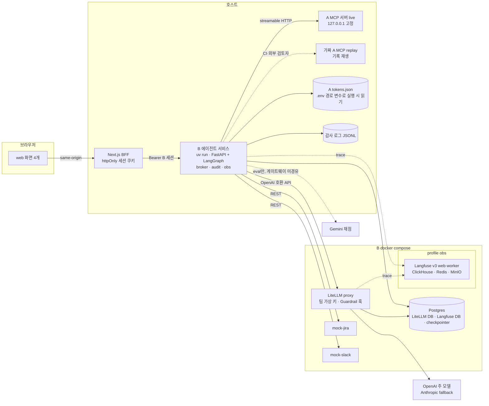
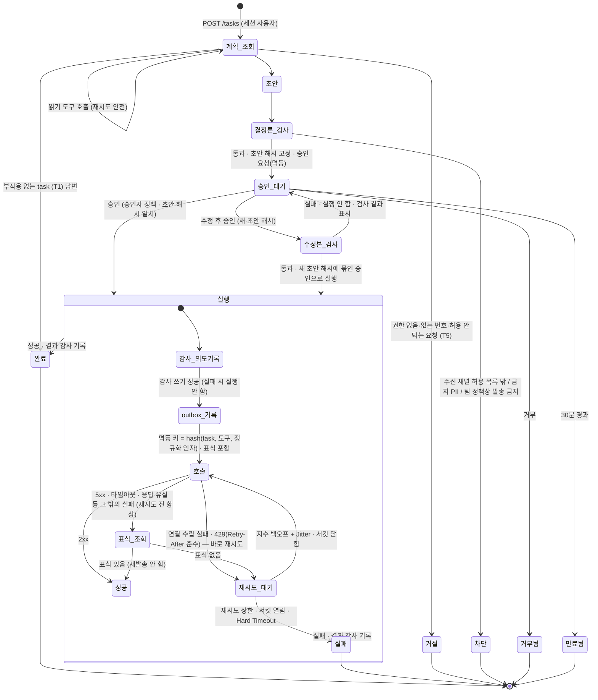
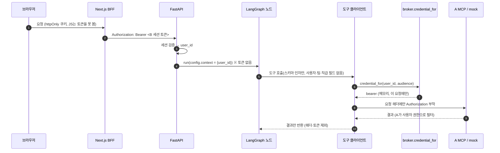
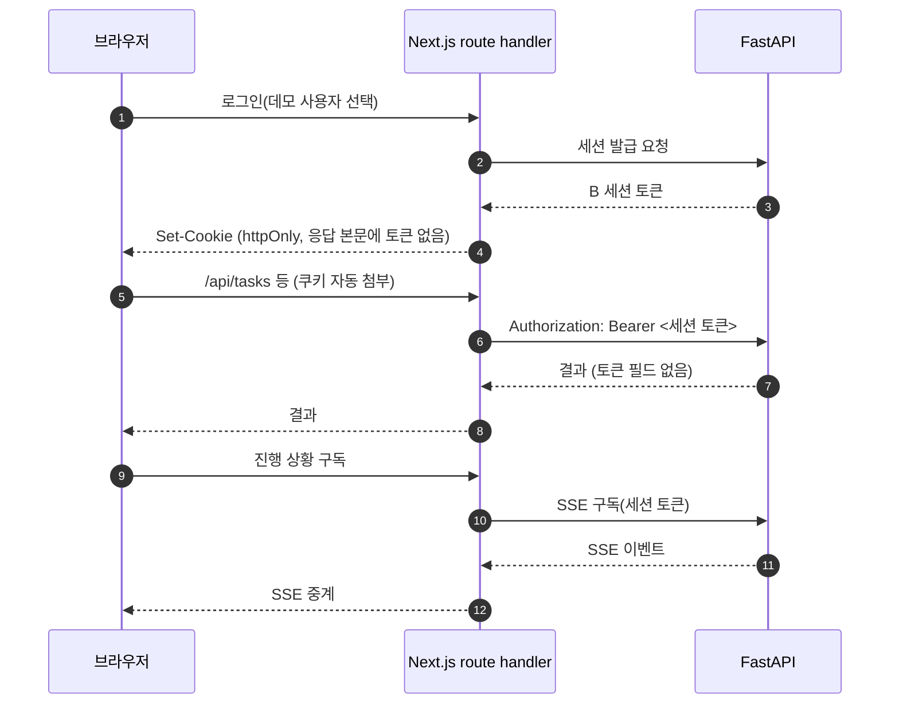

# 아키텍처

보안 경계·위협·완화와 검증 매핑은 [THREAT_MODEL.md](THREAT_MODEL.md), 결정 근거는 [ADR.md](ADR.md), 지표는 [EVAL.md](EVAL.md)를 참조한다.

표기 규칙:
- **확인 필요(구현 시 공식 문서로 확인)**: 결정 기록에서 사실 확인이 남은 항목. 단정하지 않는다.
- **미정(구현 phase에서 결정)**: 결정 기록에 없는 구현 세부. 해당 phase 설계 때 정하고 ADR에 남긴다.

## 디렉토리 구조
패키지 이름 `govops`는 미정(M0에서 확정)이다.

```
src/govops/
├── api/          # FastAPI: B 세션 인증, POST /tasks, GET /tasks/{id}, POST /tasks/{id}/approval, 진행 SSE
├── agent/        # LangGraph 단일 에이전트: 상태·노드·그래프, 실행 전 결정론 검사, 승인 정책, MAX_STEPS/MAX_COST
├── tools/        # 도구 계약(스키마·버전·부작용 여부), A MCP 클라이언트, mock REST 클라이언트, outbox·표식 조회, 타임아웃·재시도·서킷
├── broker/       # credential_for(user, audience) — 자격 증명을 꺼내는 유일한 지점
├── gateway/      # LiteLLM 호출 클라이언트(에이전트의 유일한 모델 경로), LiteLLM 안에서 도는 Guardrail 훅 어댑터
├── guardrails/   # 순수 Python 판정: 한국 형식 PII 정규식, 인젝션 패턴 사전, 팀별 정책 표 로더 (v2 분류기는 gateway 경유 호출)
├── audit/        # 감사 로그 해시체인·서명 쓰기(유일한 쓰기 지점), audit-verify
├── obs/          # trace span, 전송 전 마스킹, 로컬 JSONL / Langfuse 출력
├── costs.py      # 공급사별 비용 원장·전체 기간 상한(호출 직전 누적액 검사)
├── eval/         # 평가셋 생성·실행, TCR·정확도, Gemini 채점(게이트웨이 미경유, 별도 원장)
├── replay/       # 가짜 A MCP 서버(기록 재생), LLM 응답 기록·재생
└── mocks/        # mock-jira·mock-slack FastAPI 서비스, 장애 주입, 관리 엔드포인트
web/              # Next.js(App Router, TypeScript): 화면 4개 + BFF route handler, Tailwind, shadcn/ui
infra/            # docker-compose(LiteLLM·Postgres·mock-jira·mock-slack, profile obs: Langfuse), LiteLLM 설정, 정책 표
data/
├── contract/     # A 계약 스냅샷(도구 4개 v1) + A 커밋 해시 (커밋, 수정 금지)
├── seed/         # mock-jira 합성 티켓 JSON + manifest(추출 A 커밋 해시·개수) (커밋)
├── replay/       # A 응답 기록(syn-*만, 토큰·Authorization 없음), LLM 응답 기록(프롬프트 해시 포함) (커밋)
├── eval/         # 평가셋 60 task 정답 명세 (사람 검수 후 확정, 커밋)
├── raw/          # 커밋 안 함
└── interim/      # 커밋 안 함 (감사 서명 개인키 0600 등)
docs/results/     # 결과표, 가설 사전 등록, 감사 고정점 manifest (날짜·커밋 해시)
logs/             # 로컬 JSONL trace·감사 로그 (커밋 안 함)
tests/
```

`data/` 하위 이름(`contract/`·`seed/`·`replay/`·`eval/`)과 감사 로그 저장 경로는 미정(구현 phase에서 결정)이다. 계층 간 import 금지 규칙은 [AGENTS.md](../AGENTS.md#계층-경계)가 원본이다.

## 배치도



- 에이전트 서비스가 호스트에 있는 이유: A MCP는 `127.0.0.1` 고정이고 MCP SDK가 이 경우 Host 헤더 검사를 켠다. 컨테이너에서 `host.docker.internal`로 붙으면 거절될 가능성이 크다. **확인 필요(구현 시 공식 문서로 확인): 컨테이너에서 A의 Host 헤더 검사가 거절하는지 M1에서 실측한다.** A는 고치지 않는다(ADR-004).
- 핵심 스택(LiteLLM·Postgres·mock 2개)은 Langfuse 없이 뜨고, 이때 trace는 로컬 JSONL로 남는다. Langfuse는 `docker compose --profile obs`로만 뜬다(ADR-009).
- Postgres 인스턴스 하나에 LiteLLM·Langfuse DB를 나눠 둔다. LangGraph checkpointer DB를 같은 인스턴스에 둘지는 미정(M1에서 결정)이다.
- web을 호스트에서 `pnpm`으로 띄우는지 compose에 넣는지는 미정(M0에서 결정)이다.
- mock 관리 엔드포인트(초기화·장애 주입 설정·상태 조회)는 compose 내부 네트워크에만 연다. 호스트의 에이전트 서비스·테스트가 장애 주입을 설정하는 경로는 미정(M3에서 결정)이다.
- Docker VM은 약 16GB(A OpenSearch와 공유)다. 첫 기동 후 `docker stats`로 실측하고, 부족하면 Docker 메모리를 늘린다.

## A 연동 모드
| 모드 | A 쪽 | 용도 | 보고 수치 |
|---|---|---|---|
| live | 실제 A MCP 서버(호스트, 사용자 기동) | 개발·평가·데모 | 이 모드만 |
| replay | 기록한 A 응답을 돌려주는 가짜 A MCP 서버 | CI, 외부 검토자 | 쓰지 않음 |

- 기록은 사용자가 실행하고 합성 문서(`syn-*`)만 남긴다. 실제 규정 원문 재게시를 막는 검사 테스트를 둔다. 토큰·Authorization 헤더는 기록하지 않는다.
- 계약 고정: A `tests/contract/snapshots`(도구 4개 v1)를 A 커밋 해시와 함께 복사한다. 서비스 시작 시 live `tools/list`와 비교해 다르면 중단한다. 가짜 A도 같은 계약 테스트를 통과해야 한다. B의 MCP 클라이언트 테스트는 실제 streamable HTTP로 가짜 A에 요청한다.

## 에이전트 상태 기계

승인 노드에는 `interrupt()`만 두고 실행은 별도 노드에 둔다. LangGraph는 `Command(resume=...)` 재개 시 멈춘 노드를 처음부터 다시 실행하므로, 실행을 승인 노드에 두면 재개할 때마다 부작용이 반복될 수 있다(ADR-011).



- MAX_STEPS·MAX_COST 초과는 어느 활성 상태에서든 실패로 끝난다(값은 M5에서 정한다). 사람 승인 대기 시간은 지연·MAX_STEPS·MAX_COST에서 제외한다.
- 승인은 초안 내용 해시에 묶는다. 승인 시점의 해시와 실행할 초안의 해시가 다르면 실행하지 않는다(TOCTOU 방지).
- 승인자 정책: 기본은 요청자 본인. **전사 공지 채널 발송만 같은 팀 4급 이상**이 승인한다(A 등급은 숫자가 클수록 상위). 승인자 신원은 세션에서 정한다.
- 수정 후 승인은 수정본에 결정론 검사를 다시 돌린다. 통과하면 새 초안 해시에 묶인 승인으로 바로 실행하고, 실패하면 실행하지 않고 승인 대기로 되돌려 검사 결과를 보여 준다.
- **부작용 도구는 재시도 전에 항상 표식 조회를 한다.** 표식이 있으면 성공, 없으면 재시도다. 500·502·504 같은 5xx는 서버가 처리한 뒤 실패를 돌려줄 수 있으므로 바로 재시도하지 않는다. 바로 재시도해도 되는 것은 연결 수립 실패와 429(`Retry-After` 준수)뿐이다. 읽기 도구는 재시도해도 안전하다.
- 읽기 도구의 재시도 대상 오류와 값(횟수·백오프·서킷·Timeout)은 M3에서 정한다.

## 도구와 부작용·멱등성

| 도구 | 대상 | 부작용 | 승인 | 멱등성 전략 |
|---|---|---|---|---|
| `search_docs` | A MCP | 없음 | 불필요 | 읽기, 재시도 안전 |
| `lookup_id` | A MCP | 없음 | 불필요 | 읽기, 재시도 안전 |
| `run_sql` | A MCP | 없음 | 불필요 | 읽기(A가 SELECT만 허용), 재시도 안전 |
| `get_document` | A MCP | 없음 | 불필요 | 읽기, 재시도 안전 |
| 티켓 조회 | mock-jira | 없음 | 불필요 | 읽기, 재시도 안전 |
| 티켓 검색 | mock-jira | 없음 | 불필요 | 읽기, 재시도 안전 |
| 메시지 발송 | mock-slack | 있음 | 필요(전사 공지는 같은 팀 4급 이상) | outbox + 메시지 본문 표식 → 불확실 시 채널 이력에서 표식 조회 |
| 티켓 코멘트 | mock-jira | 있음 | 필요 | outbox + 코멘트 표식 → 불확실 시 해당 티켓 코멘트에서 표식 조회 |
| 티켓 생성 | mock-jira | 있음 | 필요 | outbox + 티켓 표식 → 불확실 시 표식으로 티켓 검색 |

- **멱등성은 B가 보장한다.** mock은 실제 서비스처럼 서버 측 중복 제거를 하지 않는다. **확인 필요(구현 시 공식 문서로 확인): 실제 Slack 메시지 발송·Jira 이슈 생성·코멘트 API에 서버 측 멱등 키가 있는지.** 결정 기록은 "없다"는 전제로 설계했다(ADR-006).
- outbox 순서: ① 감사 로그에 실행 의도 기록 → ② outbox에 멱등 키·상태 기록 → ③ 표식을 넣어 호출 → ④ 결과를 outbox·감사 로그에 기록. 같은 멱등 키가 이미 성공이면 호출하지 않는다.
- 핵심 장애는 "서버는 처리했는데 응답 유실"이다. 이때 재발송하면 중복, 포기하면 누락이므로 표식 조회로 판정한다.
- 도구 이름, 표식 형식(본문에 넣는 위치·문자열), outbox 저장소(Postgres 테이블 여부)는 미정(M1·M3에서 결정)이다.
- mock 응답 비대칭: 읽기 권한 거부는 "없음"과 구별되지 않게 응답한다(존재 자체가 기밀). 쓰기 권한 거부는 명시적 "권한 없음"이다(채널 목록은 공개 정보).
- mock-jira 티켓 조회 권한은 A와 같은 규칙(`access_level`·`access_teams`·`access_min_grade`)이다. live에서 38명 × 표본 티켓 가시성을 A와 대조하는 테스트를 둔다.

## 자격 증명 중개 흐름 (`credential_for`)



- audience: A MCP(`kodocs-mcp`), mock-jira, mock-slack. 같은 중개를 거치고 audience만 다르다. 실무 전환 시 이 함수 한 곳만 RFC 8693 토큰 교환으로 바꾼다(ADR-005).
- A 토큰 출처: `.env`의 경로 변수로 A의 `data/interim/mcp/tokens.json`을 실행 시 읽는다. B 저장소에 복사하지 않는다. 사람·에이전트는 이 파일을 열거나 출력하지 않는다.
- mock-jira·mock-slack이 받을 사용자 자격 증명의 발급 방식은 미정(M1에서 결정)이다.
- 불변식: 토큰은 state·checkpointer·trace·로그·LLM 컨텍스트에 없다(저장된 checkpoint·trace·로그를 스캔하는 테스트). 같은 task를 두 사용자가 요청하면 A 결과가 다르다.
- 한계: B 프로세스가 사용자들의 A 토큰을 보관하므로 B가 탈취되면 전원이 노출된다(ADR-005).

## 게이트웨이와 Guardrail 비대칭 구조

호출자 식별: LiteLLM **팀별 가상 키 + `user` 필드(사용자 ID) + 메타데이터 task ID**. 팀별 예산·사용량·정책은 LiteLLM 기능으로 둔다.

| 지점 | 위치 | 대상 | 동작 | Guardrail 오류·타임아웃 시 | 이유 |
|---|---|---|---|---|---|
| 입력 | LiteLLM 사전 훅(`async_pre_call_hook`) | 사용자 직접 입력 | 인젝션·금지 PII 탐지 시 **차단** | 차단(fail-closed) | 공급사로 나가기 전, 비용 발생 전에 끊는다. 사용자가 다시 쓰면 되므로 차단 비용이 낮다 |
| 도구 결과 | LiteLLM 사전 훅(다음 호출의 입력) | A 문서(간접 인젝션 문서 포함)·티켓 본문 | 탐지 부분 **격리**("정책으로 일부 제외" 표시)·기록 | 차단(fail-closed) | 도구 결과는 정상 업무 데이터가 대부분이라 통째로 차단하면 task가 깨진다. 의심 부분만 모델 입력에서 뺀다 |
| 출력 | LiteLLM 사후 훅(`async_post_call_success_hook`) | 모델 응답 | **탐지만**(trace 표시·경보) | 통과 + 경보(fail-open) | 출력은 아직 부작용이 아니다. 피해 지점은 아래 결정론 검사와 승인이 막는다 |
| 부작용 실행 직전 | 에이전트 `결정론_검사` 노드 | 발송문·수신처·티켓 내용 | 수신 채널 허용 목록, 발송문 금지 PII, 팀별 정책을 **결정론으로 강제** + 사람 승인 | 검사 실패 = 실행 안 함 | 탐지는 확률적이다. 되돌릴 수 없는 피해 지점은 확률 판정이 아니라 결정론과 승인으로 막는다 |

- PII 범위: 주민번호, 전화, 개인 이메일, 계좌·카드번호. 직원 이름·사번·담당자는 업무 데이터라 제외한다.
- 팀별 정책: 인사(HRM)·재무(FIN)·법무(LGL)는 출력 PII 탐지 시 발송 단계 진입 금지, 나머지 팀은 마스킹 후 진행. 정책 표는 설정 파일 하나이고, 서비스 시작 시 그 해시를 감사 로그에 남긴다.
- 3지점 마스킹: 입력(사전 훅), trace(전송 전 마스킹 함수), 출력(사후 훅).
- 탐지기 두 버전(M6): v1 = 규칙(한국 형식 PII 정규식, 인젝션 패턴 사전), v2 = v1 + 게이트웨이 경유 소형 분류 모델.
- 같은 사전 훅에서 사용자 입력과 도구 결과를 메시지 역할로 구분하는지, Guardrail 판정을 LiteLLM 응답의 어느 필드로 B에 돌려받아 감사 로그에 쓰는지는 미정(M4에서 결정)이다.
- fallback 모델: Anthropic Sonnet 계열. **확인 필요(구현 시 공식 문서로 확인): 정확한 모델 ID와 가격.**

## trace 구조

- **trace 하나 = task 하나.** LiteLLM의 Langfuse 연동에 B의 trace ID를 메타데이터로 넘겨 모델 호출이 같은 trace에 묶이게 한다. **확인 필요(구현 시 공식 문서로 확인): LiteLLM → Langfuse trace ID 메타데이터 키 이름.**
- span: 그래프 노드, 도구 호출, 모델 호출, Guardrail 판정, 승인 대기·결정, 멱등성(표식) 조회, 재시도·서킷 상태 변화.
- score: TCR, 정확도, Guardrail 플래그, 사람 검수.
- trace는 디버깅용이며 수정 가능하다. 책임 추적은 감사 로그가 맡는다.
- 전송 전 마스킹 함수가 PII를 가린다. 토큰·Authorization 헤더는 span 속성에 넣지 않는다.
- Langfuse를 띄우지 않으면 같은 구조를 로컬 JSONL로 쓴다.
- golden trace 두 층: CI(PR마다, 기록한 LLM 응답 + replay A + mock, 결정론)와 live 회귀 관문(사용자 실행). 비교 항목은 [EVAL.md](EVAL.md#golden-trace)를 따른다.

## 감사 로그

trace와 다르게 책임 추적용이다. 보안·부작용 사건을 전부 담고, 덧붙이기만 하며, 위변조를 탐지한다.

**기록 대상:** 부작용 생애주기 전부(초안, 승인 요청, 승인·수정·거부·만료, 실행 시도, 결과, 표식 조회), Guardrail 차단·격리, 쓰기 권한 거부, 인증 실패, 모델 호출마다 최소 기록(task, 사용자, 팀 키, 모델, fallback 여부, 비용, Guardrail 판정), 서비스 시작 시 정책 파일 해시.

**형식(JSONL 한 줄 = 사건 하나):**

```json
{"seq": 42, "ts": "2026-10-20T10:15:03.120+09:00", "prev_hash": "<직전 줄 hash>",
 "actor": {"sub": "demo-payments-g4", "act": "governed-ops-agent"},
 "event": "side_effect.attempt", "task_id": "...",
 "tool": "...", "idempotency_key": "...", "draft_sha256": "...", "mock_id": null,
 "hash": "<SHA-256>", "sig": "<Ed25519(hash)>"}
```

- `hash` = SHA-256(정규화 JSON: 키 정렬·공백 없음·UTF-8, `hash`·`sig` 제외). `sig` = Ed25519(`hash`).
- 날짜별 파일로 나눠도 체인은 이어진다. 쓰는 곳은 B 서비스의 `audit/` 한 곳이다.
- **원문 대신 내용 해시와 mock ID만** 남긴다(지울 수 없는 로그에 PII를 넣지 않는다).
- 실행 전 의도 기록, 실행 후 결과 기록. 감사 로그 쓰기에 실패하면 부작용을 실행하지 않는다(fail-closed).
- 고정점: 실행마다 마지막 `seq`·`hash`를 서명해 `docs/results/` manifest에 커밋한다. 체인만으로는 꼬리 잘라내기와 전체 재계산을 막지 못하기 때문이다.
- 키: 개인키는 gitignore된 `data/interim/`에 0600(사용자 생성), 공개키만 커밋한다.
- `make audit-verify`: 체인·서명·seq 빈틈·고정점을 검증한다.
- 위 예시의 `event` 이름과 사건별 추가 필드 목록은 미정(M4에서 결정)이다.

## BFF 인증 흐름 (httpOnly 쿠키)



- 브라우저 JS는 토큰을 볼 수 없다. "자격 증명은 LLM·trace·브라우저에도 노출되지 않는다"를 웹 계층까지 이어 간다.
- 화면 4개: 로그인(데모 사용자 선택 = B 세션 발급), 요청·진행(SSE), 승인함(초안·수신처·결정론 검사 결과·수정 차이, 전사 공지는 4급 이상만), 기록(task 상태, `audit-verify` 결과).
- 쿠키 속성(`Secure`·`SameSite`)·CSRF 대책·세션 만료 시간은 미정(M5에서 결정)이다.

## 상태 관리
- **에이전트 상태:** LangGraph state + Postgres checkpointer. state에는 사용자 ID·초안·초안 해시·도구 결과가 들어가고 토큰은 들어가지 않는다.
- **outbox:** 멱등 키별 상태(기록됨·성공·불확실·실패)와 표식. 저장 위치는 미정(M3에서 결정).
- **mock 상태:** mock 서비스 메모리 또는 파일. 관리 엔드포인트로 초기화한다. 장애 주입은 요청 순번 스크립트로 재현한다.
- **비용 원장:** 공급사별 누적액(주 모델·fallback·v2 분류기는 게이트웨이 경유, 채점은 별도 원장). 상한은 [ADR.md](ADR.md)의 ADR-007.
- **비밀 값:** API 키는 `.env`에서만 읽는다. LiteLLM 팀별 가상 키의 보관·주입 방식은 미정(M4에서 결정)이다.
