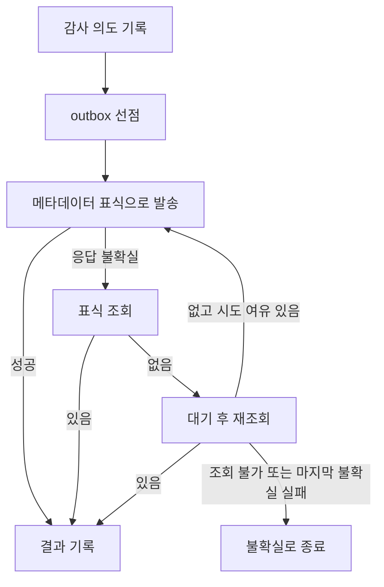

# 실제 API에 멱등 키가 없을 때 에이전트 부작용을 정확히 한 번 실행하기

이 글은 가상 회사 “해온클라우드”의 **mock 시뮬레이션**을 다룬다. 실제 Jira·Slack 연동 사례가 아니다. 서버 측 중복 제거가 없는 mock REST API에서 에이전트가 승인된 메시지·코멘트·후속 티켓을 실행할 때, 응답 유실과 조회 반영 지연을 어떻게 다뤘는지와 막지 못한 구간을 함께 적는다. 제목의 “정확히 한 번”은 설계 목표이며 임의의 지연에서 성립하는 보장은 아니다.

편집 상태: [M7 설계 4-4절](M7_DESIGN_DRAFT.md#4-4-블로그-초안-개요--실제-api에-멱등-키가-없을-때-에이전트-부작용을-정확히-한-번-실행하기)에 따른 초안. 수치는 같은 설계 4-2절의 결과 문서만 사용하며 새로 계산하지 않는다. 영상·리허설 결과는 아직 포함하지 않는다.

## 1. 문제: 서버는 처리했는데 응답이 사라졌다

요약을 팀 채널로 보내는 요청에서 타임아웃이 났다. 클라이언트는 “보내지 못했다”와 “보냈지만 응답을 못 받았다”를 구별할 수 없다. 바로 다시 보내면 중복이고, 포기하면 누락일 수 있다. 모델에게 발송 여부를 추측시키지 않고 외부 상태를 확인하는 실행기를 둬야 한다([ADR-006](ADR.md#adr-006-mock-jiraslack은-rest-서비스-멱등성은-b가-outbox와-표식-조회로-보장한다)).

## 2. 버린 접근: 본문 표식·검색·바로 재시도

본문에 식별자를 쓰면 사용자에게 보이고 사람이 편집하면서 지울 수 있다. 검색 API는 반영 지연 때문에 이미 발송된 항목을 못 찾을 수 있다. 타임아웃이나 서버 오류를 바로 재시도하는 것도 처리 후 응답 유실을 중복으로 바꾼다. 표식은 메타데이터에 넣고, 채널 최근 이력과 원 티켓의 코멘트·후속 티켓 목록으로 확인한다([ADR-018](ADR.md#adr-018-m3-결정--장애-처리-값-outbox표식-감사-최소-구현-승인자-정책-발송-범위-검사)).

## 3. 설계: outbox와 표식 조회

멱등 키는 task·도구·정규화 인자의 해시다. 실행 직전 감사 의도를 기록하고 outbox를 선점한 뒤 키를 메타데이터에 넣어 호출한다. outbox에는 원문·자격 증명 대신 해시·상태·mock ID를 둔다. 이미 성공한 키는 발송하지 않는다.

바로 재시도하는 경우는 연결 수립 실패와 `429`뿐이며 `Retry-After`를 지킨다. 그 밖의 불확실 오류는 조회 → 대기 → 재조회가 먼저다. 조회 불가나 마지막 불확실 실패를 “보내지 않음”으로 확정하지 않는다. 재시작 정리도 표식 조회만 하고 재발송하지 않는다. 실행 계약은 [ARCHITECTURE의 부작용·멱등성 절](ARCHITECTURE.md#도구와-부작용멱등성)에 있다.

## 4. 승인과 신원은 실행 경로의 일부다

LangGraph는 `Command(resume=...)`로 재개할 때 멈춘 노드를 처음부터 실행한다. 승인 노드에는 `interrupt()`만 두고 부작용 실행을 별도 노드로 나눴다. 승인은 초안 내용 해시에 묶으며 수정본에도 결정론 검사를 다시 적용한다([ADR-011](ADR.md#adr-011-hitl은-interrupt--postgres-checkpointer-승인-노드와-실행-노드를-나누고-프런트는-nextjs--bff)).

신원은 인증된 세션에서 정한다. 모델이 도구 인자로 사용자·팀·직급을 바꿀 수 없다. 발송 신원은 요청자이며 승인자는 본문만 수정한다. 전사 공지는 요청자 본인과 다른 같은 팀의 자격 있는 승인자를 요구한다. 도구 클라이언트가 요청 직전에 broker로 받은 자격 증명을 헤더에만 붙인다.

## 5. 장애 주입에서 관측한 것

다음은 [M3 live 결과 요약 30~37행](results/2026-10-07-m3-faults-live.md#결과-요약)의 문구다. 실측 환경은 live A와 mock 시스템이다.

- **절대 규칙 1(중복 부작용)**: 분모 132회에서 **중복 0건**. 95% 상한은 약 2.3%(3/132)이며 **0건은 관측값이지 증명이 아니다**.
- **F10 긴 지연(한계 시연)**: 실행된 9회 모두 **중복 1건**. 이 변형은 절대 규칙 분모에서 제외하고 별도 보고한다.
- **F10 짧은 지연**: 20/20 중복 0, 표식 조회 40회(실행당 2회)와 대기 2.0초가 매번 발생했다.
- **누락 7건(F2/after 1, F3 1, F5 2, F9 2, F10/long 1)**: 장애와 무관한 **V15 오차단**이다.
- **TCR**: 장애 처리 대상 126회(F2 continuous·F10 long·F11 제외)에서 **120/126**. 실패 6건은 모두 위 오차단이다.

중복이 없다는 결과만으로 일을 완수했다고 판단하지 않는다. 누락·최종 상태·승인 표식을 함께 봐야 한다. 긴 조회 지연은 이 설계가 실패하는 조건을 드러낸다.

## 6. 잡은 버그와 기대값을 고친 지점

| 실패 패턴 | 배운 점 |
|---|---|
| FP-040: 아무것도 보내지 않아도 중복은 없다 | 중복과 누락·최종 상태를 함께 판정한다 |
| FP-002: 시나리오 이름만 보고 서킷 열림을 기대했다 | 성공한 표식 조회가 실패 카운터를 초기화하는 실제 경로에서 기대값을 도출한다 |
| FP-005: 조회 반영 지연만 넣어 표식 조회가 실행되지 않았다 | 응답 유실과 지연을 결합하고 조회·대기·주입 증거를 확인한다 |
| FP-001: 반영 뒤 깨진 응답을 확정 실패로 분류했다 | 분류할 수 없는 오류는 불확실로 남기고 표식으로 확인한다 |

개발 기록의 근거는 [failure-patterns](../.claude/skills/failure-patterns/SKILL.md)의 해당 항목이다. 이 기록은 설계·회귀 테스트의 이유이며 새로운 성능 수치가 아니다.

## 7. 감사: trace와 책임 추적을 나누기

trace는 디버깅, 감사 체인은 누가 무엇을 승인하고 어떤 실행이 있었는지의 추적을 맡는다. 감사는 원문 대신 내용 해시와 mock ID를 JSONL에 덧붙이고 SHA-256 체인·Ed25519 서명과 git 고정점을 사용한다. 실행 전 의도 기록에 실패하면 부작용을 실행하지 않는다([ADR-012](ADR.md#adr-012-감사-로그는-trace와-분리한-해시체인--ed25519-서명-고정점을-커밋한다)).

[M4 결과 41행](results/2026-10-08-m4-audit-live.md)에서는 “변조 5종(수정, 중간 삭제, 순서 변경, 꼬리 잘라내기, 다른 키 서명)이 각각 기대한 문제 코드로 탐지됐다.” [`scene5_tail_cut` 재확인](results/2026-10-13-m6-limits-delete-live.md#감사보존)도 있다. 다만 “마지막 고정점 **뒤**만 자른 꼬리는 다음 고정점 전까지 탐지하지 못한다”([M4, 77행](results/2026-10-08-m4-audit-live.md)).

M7 기록 화면은 소유자에게 턴별 이벤트를 읽기 전용으로 보여 준다. 전역 검증 요약은 인증된 모든 사용자에게 개수·고정 코드만 노출한다. 화면의 PASS는 이 호스트 체인과 작업 트리 고정점 기준이며 외부 신뢰 기반을 추가하지 않는다([ADR-028](ADR.md#adr-028-m7-결정--기록-화면과-감사-검증-노출)).

## 8. 한계와 다음 비교의 조건

긴 조회 반영 지연에서는 중복을 막지 못하며 실제 서비스의 지연 분포·속도 제한은 검증하지 않았다. 메타데이터를 읽을 수 있는 실제 대응 필드와 서버 측 멱등 키 지원 여부는 실제 연동 전에 확인할 사항이다.

v1의 입력 차단·격리가 모든 공격을 잡은 것은 아니다. 승인·결정론 검사와 효과가 나가지 않은 경로를 구분해야 한다. v2는 정상 task 오탐으로 공식 구성에서 제외됐다. V15 오차단이 TCR을 낮췄고 groundedness·format은 채점 모델 검증 미달이다([M6 공식 구성·정확도·실패 분석](results/2026-10-15-m6-redteam-run-live.md)).

감사는 마지막 고정점 이후 꼬리·같은 키 전체 재계산·B 호스트 탈취를 막지 못한다. 소프트 삭제 뒤 원문은 다음 보존 정리까지 남고, 턴 색인이 정리되면 감사 레코드가 있어도 화면은 404다. 평가 정답지(`data/eval`)는 공식 test 동결 뒤 공개한다. 이후 비교에는 새 held-out 세트가 필요하다. 합성 템플릿·반복 실행의 관측을 실제 공격에 대한 보장으로 바꾸지 않는다.
